# Maia フレームワーク学習資料

## 目次

- [1. CSR(client side rendering)アーキテクチャ全体構造の理解](#1-csrアーキテクチャ全体構造の理解)
- [2. 依存性注入・マルチプロジェクトの実践メモ](#2-依存性注入マルチプロジェクトの実践メモ)
- [3. VS Code拡張機能（バックエンド開発用）](#3-vs-code拡張機能バックエンド開発用)
- [4. バックエンドのコンフィグ](#4-バックエンドのコンフィグ)
- [5. バックエンドの実装（Spring Securityなし）](#5-バックエンドの実装spring-securityなし)
- [6. CRUDとEntityの構築](#6-crudとentityの構築)
- [7. VS Code拡張機能（フロントエンド開発用）](#7-vs-code拡張機能フロントエンド開発用)
- [8. フロントエンドのコンフィグ](#8-フロントエンドのコンフィグ)
- [9. Vueの構築とリクエストの流れ](#9-vueの構築とリクエストの流れ)
- [10. Spring Securityについて](#10-spring-securityについて)
- [11. アプリをテストする（単体テスト・結合テスト・CI/CD）](#11-アプリをテストする単体テスト結合テストcicd)
- [12. 用語総まとめ（付録）](#12-用語総まとめ付録)

---

## 1. CSRアーキテクチャ全体構造の理解

### 1. 依存関係の逆転

依存関係の逆転は、ライブラリやインストール可能なツールの名前ではなく、コードをどのように設計するかについての原則です。

通常、上位の層である業務ロジックが、下位の層であるデータベースの具体的な技術へ直接依存すると、データベースを変更したときに業務ロジックまで変更する必要が生じます。

依存関係の逆転では、上位層の業務ロジックが下位層の技術的な詳細へ直接依存しないようにします。代わりに、インターフェースを境界として使います。業務ロジックは「必要なデータ操作」をインターフェースに対して依頼し、実際にどのデータベース技術を使うかは下位側の実装に任せます。

この構造にすると、データベースなどの技術的詳細を変更しても、業務ロジックへの影響を抑えられます。また、各層を分けてテストしやすくなり、保守性とテスト容易性を高められます。

### 2. Dependency Injection

Dependency Injection、つまり依存性注入は、オブジェクトが必要とする別のオブジェクトを、自分で`new`して作成・管理するのではなく、Springに用意してもらう考え方です。

たとえば、ServiceがRepositoryを必要とする場合、Serviceの中でRepositoryを直接`new`するのではなく、Springが管理しているRepositoryをServiceへ渡します。これにより、ServiceはRepositoryの具体的な作成方法を自分で管理せずに済みます。

依存関係の逆転が「どの層がどの層へ依存するか」という設計上の方向を扱うのに対し、Dependency Injectionは必要な依存オブジェクトを実際に渡す仕組みです。両者は関連していますが、同じ言葉ではありません。

### 3. マルチプロジェクト構成

マルチプロジェクト構成とは、1つのルートプロジェクトの下に複数のサブプロジェクトを配置する構成です。各サブプロジェクトは、それぞれ独立した`build.gradle`と`src`フォルダーを持ちながら、必要に応じて別のサブプロジェクトへ依存できます。

この構成では、アプリケーションの層ごとにサブプロジェクトを分けます。どのサブプロジェクトがどこへ依存できるかをGradleの設定で定義できるため、層のルールをコンパイル時に確認できます。誤った依存関係がある場合、実行してからではなく、ビルド時に問題を見つけやすくなります。

要するには、マルチプロジェックを導入ということで、表面にプロジェックを複雑になるけど、実際に開発者の認識負荷ということを低減します、だからプロジェックをシンプルになっています

### 4. 各サブプロジェクトの責務

#### `application-core`

`application-core`は、業務ロジックだけを担当します。ここには、商品や利用者など、アプリケーションの業務ルールを表現するコードを置きます。

この層は、HTTPリクエストをどのように送受信するかや、データベースへどのように接続するかを知りません。つまり、Web通信やデータベースの具体的な技術ではなく、業務上「何をするか」を表現する場所です。

#### `infrastructure`

`infrastructure`は、データベースとの通信を担当します。ここにはMyBatisやOpenAPIに関係するコードが含まれます。

MyBatisはバックエンド内部で使われ、データベースの内容をJavaのデータアクセスコードへ対応付けます。たとえば、`ProductEntity.java`や`ProductMapper.java`などが該当します。これらはデータベースの構造に近いコードであり、インフラストラクチャ層の内部で使います。

OpenAPIはAPI仕様書を読み取り、フロントエンド用のAPI呼び出し関数とTypeScriptの型を生成します。MyBatisがバックエンド内部のデータベースアクセスを担当するのに対し、OpenAPIの生成コードはフロントエンドがバックエンドAPIを呼び出すために使われます。

この2つの仕組みは、`api-specification.json`を共通の基準として使うことで、バックエンドが公開するAPIとフロントエンドが呼び出すAPIの形を一致させます。

#### `web`

`web`は、HTTPリクエストの送受信を担当する、アプリケーションの最も表層にある部分です。Controllerなどを通じて外部からのリクエストを受け取り、処理結果をレスポンスとして返します。

`web`は他のサブプロジェクトに依存するため、最終的には`web`を起動対象として`bootRun`を実行します。ここでいう「表層」とは、利用者やフロントエンドから最初に見える入口に近いという意味です。

#### `system-common`

`system-common`は、複数のサブプロジェクトから共通して使う機能を担当します。たとえば、メッセージ処理のコードや共通定数などを置きます。

共通機能を一か所に置くことで、同じ処理や定数を各サブプロジェクトへ重複して書く必要がなくなります。

### 5. 開発者から流れ（手動）

開発者がコードを作成し、データベースのテーブルからフロントエンドのAPIクライアントまでつながる流れは次のとおりです。（注意：この流れは自動ではなく、MyBatis GeneratorとOpenAPI Generatorはどちらも開発者が手動でコマンドを実行する必要がある）（ビジネスロジックオブジェクトを中心とした流れ）

開発者が設計した`データベーステーブル（永続データベース）`

→ **MyBatis Generator**がテーブル構造を読み取る(永続的データベースを一時起動は必要です)

→ `ProductEntity` / `ProductMapper`を自動生成する。これらは主に`infrastructure`内部で使う。データベース向けるためです

→ `ProductRepositoryImpl`が`Product.java`を`ProductEntity`に変換して、`ProductMapper`を呼び出す

→　`Product.java`という、`データベース構造とHTTP構造`から同時に独立したビジネスロジック為のドメインオブジェクトになる（中心、`依存関係の逆転`のため）

→ `ProductController`が`Product.java`の形を`HTTPエンドポイント`として返す(@RestControllerというアノテーションの機能)、`ProductController`を介して、`API`ここに設計、実装する

→ `springdoc-openapi`がControllerを自動的に調べる

→ `api-doc`と`api-specification.json`に、Productの形とエンドポイントが自動記録される

→ **OpenAPI Generator**がTypeScriptの型定義とフロントエンド用APIクライアントを生成する

→ `TypeScriptの型 + APIクライアントコード`

→ `Vueコンポーネント`が`axios`を使ってAPIを呼び出す

`ProductEntity`はデータベースに近い形式、`Product`は業務ロジックに近い形式です。`ProductRepositoryImpl`は、この2つの形式の間を変換する場所です。変換を行うことで、データベースの形式をそのまま業務ロジックへ持ち込まずに済みます。

### 6. クライアントから見た実行時の流れ（自動）

利用者がVueのボタンをクリックしてからデータベースが更新されるまでの、より具体的な流れは次のとおりです。（SpringSecurityあり）（フロントエンドからデータベースへの流れ）

`Vueコンポーネント`

→ `TypeScriptの型 + APIクライアントコード`

→ `Axios`がリクエストを組み立てる

→ `HTTPリクエスト`が送信される

→ `Viteプロキシ`が転送する

→ `Spring Security`が認証・認可を確認する

→ `DispatcherServlet`が`HTTP`を適切なControllerへ振り分ける

→ `Controller`はSpringアノテーションを介して、返した結果`HTTPリスポンス`に変更して、ApplicationServiceに処理を依頼する

→ `ApplicationService`はビジネスロジックを適用して、Repositoryに処理を依頼する 

→ `RepositoryImpl`はデータをProductEntityに変換し、MyBatisに処理を依頼する、具体的に、`RepositoryImpl`は`mapper.xmlとmapper.java`を利用して、jdbcを介して、`SQL`をデータベースへ送ります

→ `MyBatis`がSQLを実行する

→ `データベース`が更新される

処理結果は、基本的にこの流れを逆向きに戻り、最終的にVueコンポーネントへ返される。

OpenApiとMyBatis二つは繋がっていない、ビジネスロジックオブジェクト、即ち`Product.java`を介して、共通できます

### 7. 全体像

この構成では、データベースのテーブルから生成されたコード、業務ロジック、HTTP API、フロントエンドのTypeScriptコードが、それぞれの役割に分かれています。

`MyBatis Generator`はデータベースからバックエンド内部で使うコードを作り、`springdoc-openapi`はControllerからAPI仕様を作り、`OpenAPI Generator`はその仕様からフロントエンド用の型とAPI呼び出し関数を作ります。

各層の間でデータを適切に変換し、依存関係をインターフェースで管理することで、Web通信、業務ロジック、データベースの変更が互いに広がりすぎない構造を目指します。


---

## 2. 依存性注入・マルチプロジェクトの実践メモ

通常、上位の層（ビジネスロジック、業務ルール）が下の層（データベースなどの技術）に直接に頼ると
データベースを変えるたびに、ビジネスロジックを書き直しは必要です。
依存関係の逆転させると、ビジネスロジックは「こういう操作をしたい」というインターフェースだけを見ます。
関数の定義を関心しない、実際にどう操作するかは、下の層は後で決める。
目的は、技術を変えても、ビジネスロジックを壊れない。
東京にアパートを探したいときに、専門のアパート探すアージェントに依頼します。

springを使って、自分がnewを使用して必要な部品を作らず、spring自動で
作って渡しくれることができる。この特徴は依存性注入ということです。

コーディングレベルには、Springアノテーションを使うと、どのjavaオブジェクトは
はどのオブジェクに依存するか理解できます。
依存性注入を使わないなら、このようなJavaを書かなけらえばならない：
```java
public class ProductApplicationService {
  private ProductRepository repository = new ProductRepositoryImpl();
}
```
一旦newを使うと、具体的なjavaクラスを選択しなければならない
但し、理想的に、一つのクラスインターフェースに対して、複数の実装があります。たとえば、本番環境ための実装、テストための実装（ビジネスロジックをテストする時に本物のデータベースを触れない方がいいです）
直接にnewを使うと、この疎結合開発流れを違反します、それはハードコーディングです。

Maiaということで、マルチプロジェクトという仕組みです。
サブプロジェクト同士は、お互いに依存関係を設定しました。
とりあえず、infrastructure, application-core, system-common, web四つの部分です。サブプロジェクトのbuild.gradleの中に,詳細な依存関係を設定できます
```groovy
dependencies {
  ...

  implementation project(':application-core')
  implementation project(':infrastructure')
  implementation project(':system-common')

  ...
}
```
以上はサブプロジェクトwebのbuild.gradleのdependencies部分です、ということで、webはapplication-core,infrastructure,system-commonに依存します。


---

## 3. VS Code拡張機能（バックエンド開発用）

バックエンドアプリケーションを開発するために、Visual Studio Code へ以下の拡張機能をインストールする。

### Spring Boot Extension Pack

Spring Boot アプリケーションの**開発とデプロイ**を提供する。

- 複数の拡張機能がセットになっているため、個別にインストールする手間が省ける。

### Extension Pack for Java

Java アプリケーションの**作成・テスト・デバッグ**等の基本的な機能を提供する。

以下の拡張機能が追加でインストールされる:

- **Gradle for Java** — アプリケーションの起動で利用する
- **Language Support for Java(TM) by Red Hat** — コード補完やエラーレポートを提供する

### Lombok Annotations Support for VS Code

Java アプリケーションにおける **Lombok アノテーションのサポート**を提供する。

- この拡張機能がないと、`@Data` などで自動生成されたゲッター・セッターをエディタが認識できず、エラー扱いになる。

### Checkstyle for Java

Checkstyle の**違反に関するリアルタイムのフィードバック**と、**簡単な修正アクション**を提供する。

- チーム全体でコーディングスタイルを統一しやすくなる。

---

#### まとめ

これらの拡張機能を組み合わせることで、コーディングからデバッグ、コード品質の維持まで、開発の一連の流れを効率化できる。


---

## 4. バックエンドのコンフィグ

### 1. バックエンドプロジェクトの準備

ここでは、Spring Bootを使ったバックエンドの土台を作ります。「サーブプロジェクト」という表現は、ここではサーバー側で動くバックエンドプロジェクトを指します。

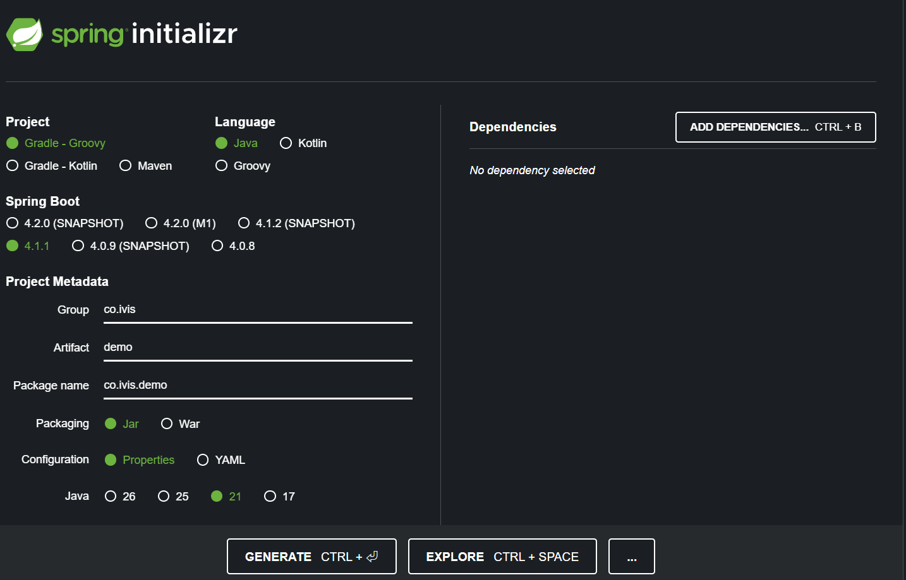

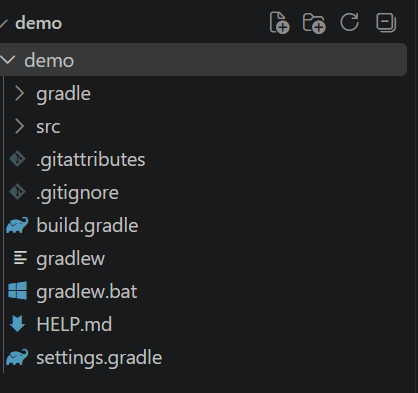

このプロジェクトでは、1つの大きなプロジェクトにすべてのコードを置くのではなく、複数のサブプロジェクトに分割する「マルチプロジェクト構成」を採用します。ルートプロジェクトの下に、たとえば次のようなサブプロジェクトを置きます。

- `application-core`: アプリケーションの中心的な処理や業務上のルールを置く場所
- `infrastructure`: データベースや外部サービスなど、技術的な接続部分を置く場所
- `system-common`: 複数のサブプロジェクトから共通して使う機能を置く場所
- `web`: HTTPリクエストを受け付けるWeb層。ControllerやSpring Bootの起動設定などを置く場所

マルチプロジェクト構成では、ルートプロジェクトが全体を管理し、各サブプロジェクトが自分の責任範囲を担当します。そのため、展開したSpring Bootプロジェクトをルートディレクトリへ移動した後、ルート側に最初から用意されている不要な`src`ディレクトリを削除します。ここでいう削除は、必要なサブプロジェクトの`src`を削除するという意味ではありません。

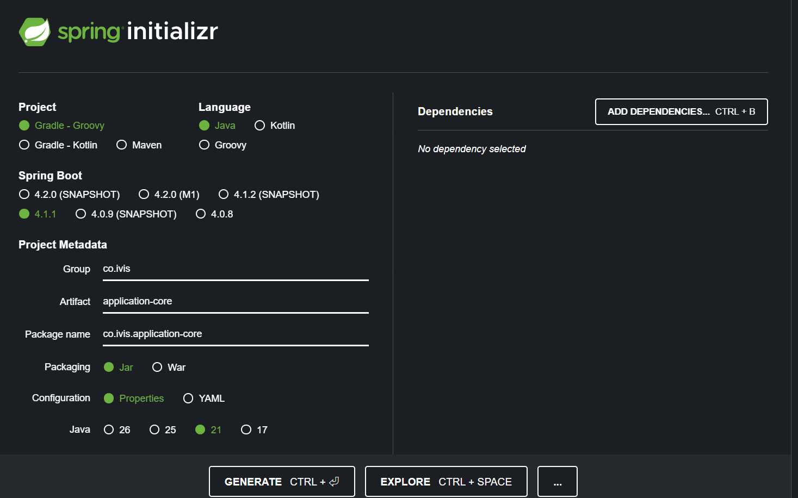

### 2. VS Codeとコード品質チェックの設定

サーバープロジェクトを正しく認識できるように、`.vscode/settings.json`を作成します。これは、VS Codeにこのプロジェクトの開発環境や使用するツールを伝える設定ファイルです。

設定内のプレースホルダーは、実際に使用するバージョンへ置き換えます。バージョンを固定することで、開発者ごとに異なるバージョンが使われることを防ぎ、同じコードを同じ条件でビルドしやすくなります。設定方法の詳しい説明は、[MAIAの共通プロジェクト設定ガイド](https://maia.alesinfiny.org/guidebooks/how-to-develop/csr/java/common-project-settings/#common-tasks)を参照します。

- **Checkstyle**: Javaのコードが決められた書式や命名規則に従っているかを確認するツール。使用するバージョンは[CheckstyleのMaven Repositoryページ](https://mvnrepository.com/artifact/com.puppycrawl.tools/checkstyle)から選びます。
- **SpotBugs**: Javaコードに潜在的なバグや危険な実装がないかを静的解析するツール。Gradleプラグインのバージョンは[SpotBugs Gradle PluginのMaven Repositoryページ](https://mvnrepository.com/artifact/com.github.spotbugs.snom/spotbugs-gradle-plugin)から選びます。
- **Checkstyle設定ファイル**: どの書式ルールを適用するかを定義するファイル。[Checkstyle公式の`google_checks.xml`](https://github.com/checkstyle/checkstyle/blob/master/src/main/resources/google_checks.xml)を取得し、`checkstyle.xml`へリネームして`config/checkstyle/checkstyle.xml`に配置します。`config/checkstyle`ディレクトリが存在しない場合は作成します。

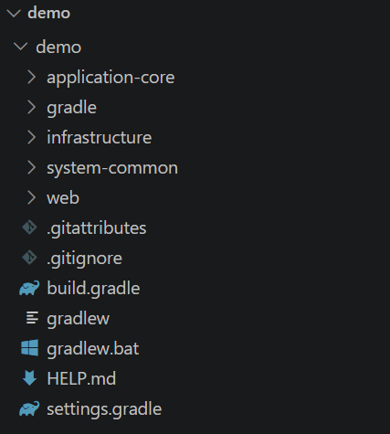

画像中の特定の設定行には「オプショナル」と書かれているものがあります。オプショナルとは、その設定がなくても基本的なビルドはできるものの、必要に応じて追加できるという意味です。設定の意味を確認せずに、すべての行を必須だと考える必要はありません。

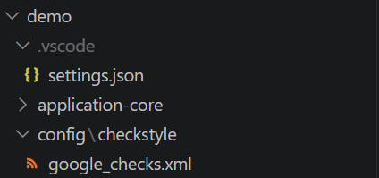
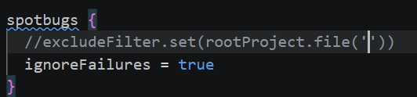

### 3. サブプロジェクトごとの設定

ルートプロジェクトから各サブプロジェクトをビルドできるように、サブプロジェクトごとに個別設定を行います。まず`application-core`を設定し、設定後にルートディレクトリからビルドします。ビルドが成功すれば、そのサブプロジェクトの設定が少なくともGradleから認識されていることを確認できます。

`infrastructure`、`system-common`、`web`は、Spring Bootを使ってそれぞれ個別のサブプロジェクトとして作成します。次の画像は、CheckstyleやSpotBugsのインストール手順ではなく、各サブプロジェクトをSpring Bootで作成する画面です。

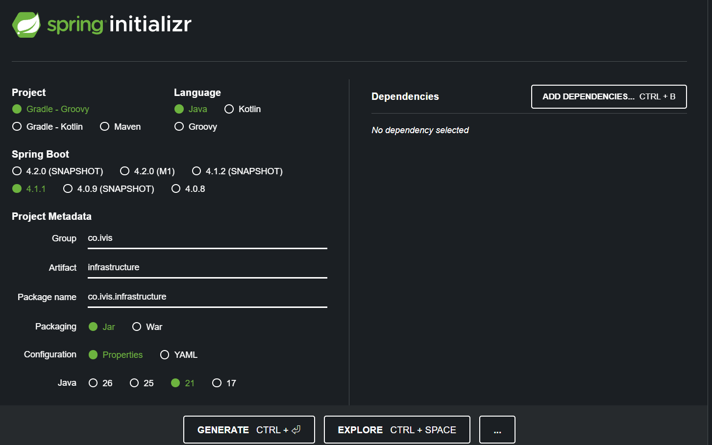
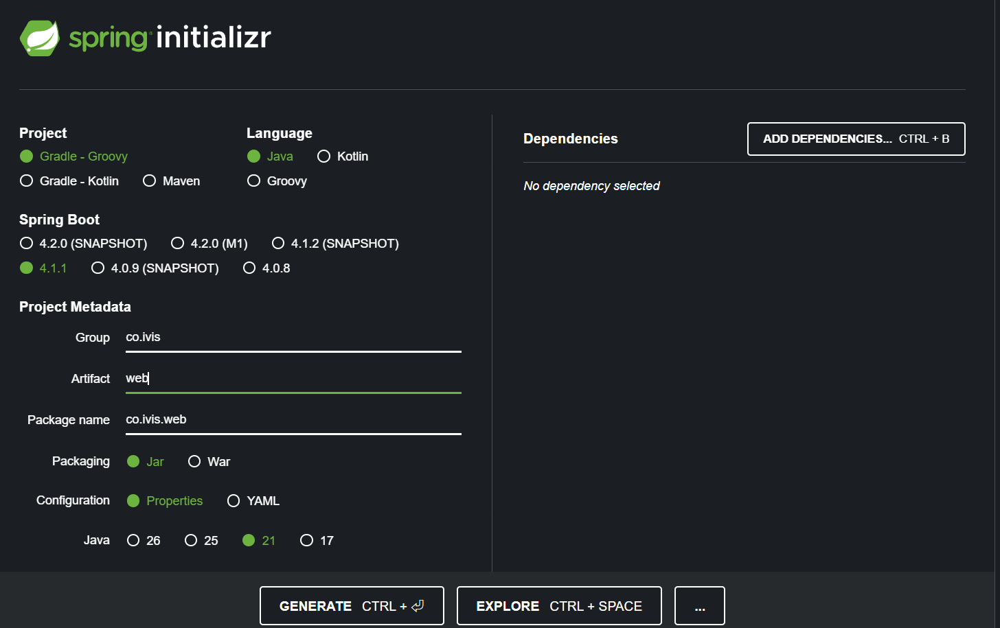
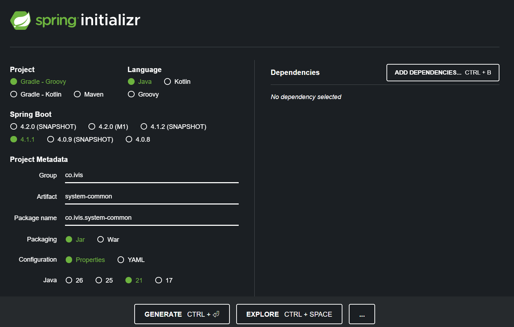

同じ手順で設定しますが、各サブプロジェクトの責任は異なります。依存するライブラリや実行に必要な設定まで完全に同じとは限りません。

`web`プロジェクトでは、アプリケーションが使用するデータベースの設定も行います。開発環境では、設定が簡単で使い捨てやすいH2を使うことが推奨されています。本番環境では、PostgreSQLなど、運用要件に合ったデータベースを選択します。本番環境でどのデータベースを使うかは、性能、バックアップ、運用体制、既存システムとの互換性などを考慮して決めます。

各サブプロジェクトをビルドできれば、個別設定は完了です。

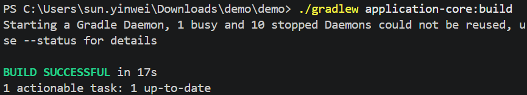
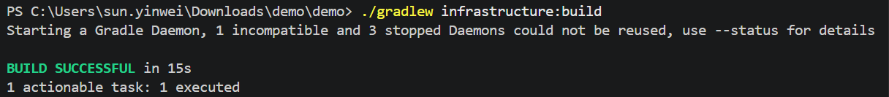
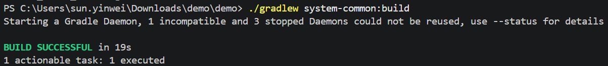
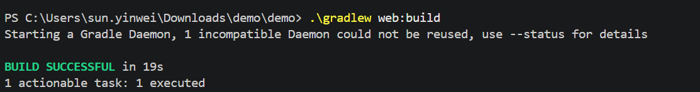

### 4. 依存ライブラリとバージョンの一元管理

ライブラリ名やバージョンを各`build.gradle`へ直接書くことをハードコーディングと呼びます。手早く設定できる一方で、同じライブラリのバージョンがファイルごとに異なる、更新漏れが起きる、といった問題につながります。

そこで、`demo/dependencies.gradle`のような共通ファイルを作り、依存ライブラリ名とバージョンを一か所で管理します。各サブプロジェクトの`build.gradle`は、その共通定義を参照するように更新します。

この方法の利点は、バージョンを一度変更すれば複数のサブプロジェクトへ同じ変更を適用できることです。また、プロジェクト全体で互換性のあるライブラリの組み合わせを維持しやすくなります。更新後は、再びルートディレクトリからビルドして、すべての依存関係が解決できることを確認します。

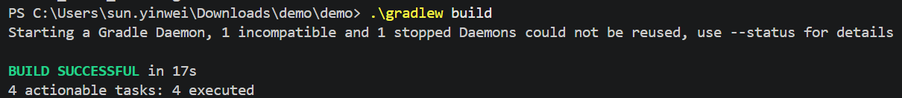

### 5. メッセージの管理

エラーメッセージや画面に表示するメッセージをJavaコードへ直接書くと、修正や翻訳が難しくなります。そこで、`application-core`と`system-common`にそれぞれ`messages.properties`を作成します。

- `application-core/messages.properties`: 業務ルールに関するメッセージ
- `system-common/messages.properties`: 複数の機能で共通して使うメッセージ

さらに、`web`プロジェクトの`application.properties`に`spring.messages.basename`を設定します。これにより、Springが指定されたメッセージファイルを読み込み、メッセージキーから実際の文章を取得できるようになります。

メッセージをキーで管理すると、文章を変更しても業務ロジックのコードを変更せずに済みます。将来、日本語と英語など複数の言語に対応する場合にも、この方式を拡張できます。

### 6. 集約例外ハンドラーとRFC 9457

アプリケーションの複数の場所で例外を個別に処理すると、APIごとにエラーの形式がばらばらになります。クライアント側はエラーごとに異なる処理を実装する必要があり、保守が難しくなります。

そこで、集約例外ハンドラーを使います。これは、Controllerなどで発生した例外をアプリケーションの共通入口で受け取り、クライアントへ返すエラーレスポンスを統一する仕組みです。「集約」とは、複数の場所にある例外処理を一つの方針でまとめるという意味です。

RFC 9457は、HTTP APIで問題が発生したときに返すエラー情報の形式を標準化する仕様です。RFCは`Request for Comments`の略で、技術仕様を提案・公開する文書の仕組みです。`9457`はその文書番号です。

RFC 9457に沿ったエラーでは、たとえばエラーの種類、概要、詳細、発生した場所、HTTPステータスなどを、クライアントが読み取りやすい構造で返します。これにより、バックエンドはAPI全体でエラー形式を統一でき、フロントエンドなどのクライアントは一貫した方法でエラーを表示できます。

ただし、クライアントへ返す情報と、開発者向けのログに記録する情報は分ける必要があります。クライアントには安全で理解しやすいメッセージを返し、詳細なスタックトレースや内部情報はログへ記録します。内部情報をそのままクライアントへ返すと、機密情報の漏えいや攻撃の手がかりになる可能性があります。

### 7. SLF4Jによるログ

SLF4Jは、Javaアプリケーションからログを出力するための共通インターフェースです。ログとは、アプリケーションで何が起きたかを後から確認するための記録です。たとえば、処理開始、処理完了、入力値の検証失敗、予期しない例外などを記録します。

SLF4J自体は、ログをファイルへ書き込む具体的な仕組みではありません。アプリケーション側はSLF4JのAPIを使い、実際の出力処理はLogbackなどのロギング実装へ任せます。この分離により、アプリケーションコードを大きく変更せずにログ実装を変更できます。

ログには、開発者が原因を追跡するために必要な情報を記録します。ただし、パスワード、アクセストークン、個人情報などの機密情報を不用意に記録してはいけません。

### 8. MyBatisとO/Rマッピング

MyBatisは、実行中のアプリケーションがデータベースと通信するために使うライブラリです。MyBatisはO/Rマッパーの一種で、Javaのオブジェクトと、データベースの表形式のデータであるSQLの行を対応付けます。

ここでいうO/Rは、Object/Relationalの略です。

- **Object**: Javaのクラスやインスタンス。たとえば`User`オブジェクト
- **Relational**: データベースのテーブル、行、列
- **Mapping**: 一方の形式をもう一方の形式に対応付けること

たとえば、`users`テーブルの1行をJavaの`User`オブジェクトへ変換したり、`User`オブジェクトの値をSQLの`UPDATE`文のパラメータへ渡したりします。MyBatisは、SQLを完全に隠すのではなく、開発者がSQLを明示的に管理しながらJavaコードと接続できる点に特徴があります。

### 9. MyBatis Generator

MyBatis Generatorは、アプリケーションの実行中に動くライブラリではありません。開発者がターミナルから手動で実行する、一度限りのコード生成ツールです。

このツールは、既存のデータベーステーブルを確認し、その構造をもとにJavaファイルやXMLファイルを生成します。テーブルの構造が変更されたときに再実行することで、毎回同じ定型コードを手書きする手間を減らせます。

具体的には、主に次のファイルを生成します。

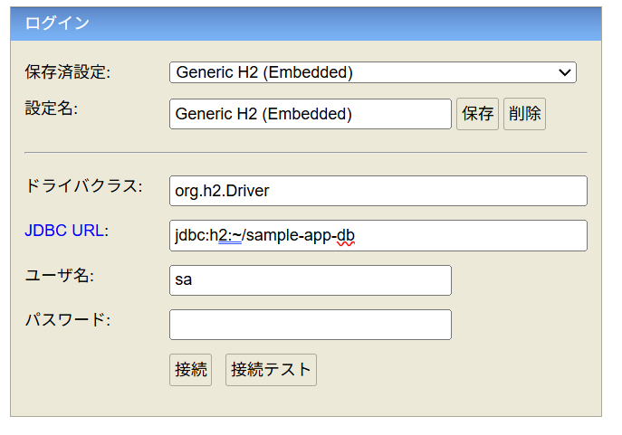

- **Entityクラス**: データベースのテーブルの形に対応するJavaオブジェクト
- **Mapperインターフェース**: データベース操作をJavaメソッドとして表すインターフェース
- **XMLファイル**: 実際のSQL文を定義するファイル。SQLの中にJavaオブジェクトの値を差し込むための設定も記述する

生成ツールとMyBatisは役割が異なります。Generatorはコードを作るための開発時ツールであり、MyBatisはアプリケーション実行時に生成されたMapperやXMLを使ってデータベースへアクセスする仕組みです。

### 10. H2データベースの設定

`web/application.properties`では、アプリケーションが接続するデータベースのURLなどを設定します。たとえば、次の設定はH2のインメモリデータベースを指定しています。

```properties
spring.datasource.hikari.url=jdbc:h2:mem:yourdbname
```

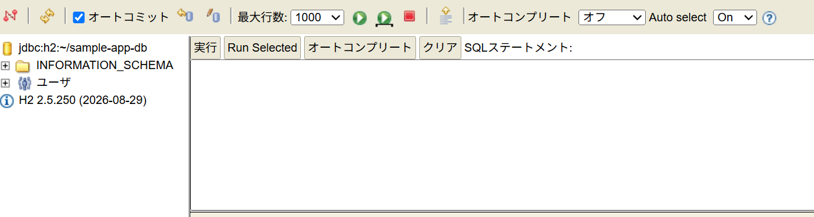

`mem`は`in-memory`の略で、データベースをメモリ上に作るという意味です。通常、アプリケーションを終了するとデータは失われます。テストや一時的な開発環境に向いています。

一方、次のようなURLはファイルへ保存する永続的なH2データベースを表します。

```text
jdbc:h2:~/xxx
jdbc:h2:C:/path/xxx
```

永続的とは、アプリケーションを終了してもデータをファイルから再読み込みできるという意味です。ただし、どちらもH2という同じデータベース製品を使っており、違いは主にデータの保存場所と保存期間です。

### 11. MyBatis Generatorの実行とトラブルシューティング

次のGradleタスクを実行すると、MyBatis Generatorを起動できます。

```text
.\\gradlew infrastructure:runMyBatisGenerator
```

このコマンドは、ルートプロジェクトのGradle Wrapperを使い、`infrastructure`サブプロジェクトに定義された`runMyBatisGenerator`タスクを実行します。Gradle Wrapperは、プロジェクトが指定したGradleのバージョンを使ってビルドやタスクを実行するための仕組みです。

ビルドやコード生成に失敗した場合は、次の点を順番に確認します。

- ファイルやフォルダの構造が設定と一致しているか。不要な入れ子のフォルダがあると、Gradleがファイルを見つけられないことがあります。
- H2が同時に複数の接続を許可しない設定になっていないか。Generatorとアプリケーションを同時に起動すると、接続競合が起きる場合があります。
- H2のデータベースバージョンと、設定ファイルやドライバーのバージョンが一致しているか。
- Gradleが設定された依存ライブラリを実際にダウンロードできるか。GitHubなどに存在する最新バージョンでも、Gradleの設定や公開形式によって取得できない場合があります。
- 利用できないH2バージョンを指定している場合は、互換性のあるバージョンでデータベースを作り直す必要があります。
- ブラウザやH2コンソールが以前のセッション情報をキャッシュしていないか。古い接続先やセッションが残っていると、現在の設定と違うデータベースへ接続しているように見えることがあります。

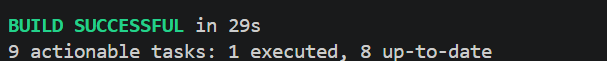

問題を切り分けるときは、まずエラーメッセージの最初の原因を確認します。後続のエラーは、最初の設定ミスが連鎖して発生しているだけの場合があります。

### 12. 現時点で完成している範囲

ここまでで、バックエンドのアーキテクチャの基礎と設定が完成し、ビルドやコード生成が動作することを確認します。ただし、これはアプリケーションの土台ができたという意味であり、業務ロジックやAPIエンドポイントが実装済みという意味ではありません。

次の段階では、この土台の上にController、ApplicationService、Repositoryなどを実装し、実際の業務ロジックとAPIを作成します。


---

## 5. バックエンドの実装（Spring Securityなし）

### 1. 各アノテーションと層の役割

まず、Spring Bootのバックエンドを構成する主要な部品の役割を整理します。アノテーションとは、クラスやメソッドに付ける目印で、Springにその部品をどのように扱わせるかを伝えるものです。

#### `@RestController`

`@RestController`は、JavaのオブジェクトをJSON形式のテキストへ変換し、HTTPレスポンスとしてネットワーク越しに返すControllerであることをSpringへ伝えます。JSONは、フロントエンドとバックエンドの間でデータを交換するためによく使われる形式です。

このアノテーションがない場合、Springはメソッドの戻り値をJSONのデータではなく、表示するHTMLテンプレートの名前として解釈することがあります。その場合、APIのデータを返す代わりに、サーバー上のWebページを探して返そうとします。

#### `@Service`

`@Service`は、そのクラスがアプリケーションの業務ロジックを担当する部品であることをSpringへ伝えます。たとえば、「在庫がある場合だけ注文を受け付ける」「この条件を満たす利用者だけ更新できる」といった、人間が決めたルールをここで実行します。

`@RestController`がWebリクエストの入口を担当するのに対して、`@Service`は業務上の判断を担当します。`@Repository`はデータベースとの読み書きを担当します。このように役割を分けることで、1つのクラスに処理が集中することを防ぎます。

### 2. Entityとドメインオブジェクトを分ける理由

`ProductEntity`は、データベースのテーブル構造を直接反映するJavaクラスです。たとえば、テーブルの列に対応するフィールドや、MyBatisがデータを読み書きするために必要な形式を持ちます。

しかし、業務ロジックの中で`ProductEntity`を直接使うと、データベースの構造変更が業務ロジック全体へ影響しやすくなります。たとえば、テーブルの列名や保存形式を変更しただけで、ControllerやServiceの処理まで修正が必要になる可能性があります。

そこで、業務ロジック用に`Product.java`を用意し、データベース接続用に`ProductEntity.java`を使い分けます。`Product.java`は、データベースの細かい構造ではなく、「商品」という業務上の概念を表す通常のJavaオブジェクトです。これをドメインオブジェクトと呼びます。

この分離は、Dependency Inversion Principleの考え方にも関係します。上位の業務ロジックが、下位のデータベースの具体的な形式に直接依存しないようにします。データベース側の変更をRepository周辺に閉じ込めやすくなり、業務ルールの変更とデータ保存方法の変更を別々に扱えます。

### 3. MyBatisが生成したコードの確認

MyBatis GeneratorはEntityやMapperなどのコードを自動生成します。ただし、自動生成されたコードを無条件に信頼するのではなく、実際のテーブル構造、Javaの型、Mapperのメソッド、SQLの内容が意図どおりに対応しているかを確認します。

自動生成コードとの整合性を確認することは、RepositoryImplを正しく実装するためにも重要です。生成されるコードの種類や内容は、以前設定した`mybatisGeneratorConfig.xml`によって決まります。つまり、この設定ファイルを変更すると、生成されるEntity、Mapper、XMLなどの形も変わる可能性があります。

### 4. リクエストがデータベースへ到達する流れ

HTTPリクエストは、次の順番で各層を通過します。

`HTTP request` → `Controller` → `Service` → `Repository interface` → `Repository Implementation` → `MyBatis` → `実際のデータベース` → `データが戻る`

それぞれの役割は次のとおりです。

1. **Controller**はHTTPリクエストを受け取り、入力値を読み取ります。Controllerは通常、業務上の判断を自分で実行せず、ApplicationServiceへ処理を依頼します。
2. **ApplicationService**は業務ロジックの中心です。必要なルールを適用し、データが必要なときはRepositoryインターフェースを呼び出します。
3. **Repositoryインターフェース**は、業務ロジック側が必要とするデータ操作をメソッドとして宣言します。ここでは「何を依頼できるか」を定義し、データベースへの具体的な接続方法は隠します。
4. **RepositoryImpl**はRepositoryインターフェースを実装するクラスです。業務ロジック側の`Product`と、データベース側の`ProductEntity`を変換し、MyBatisへ処理を依頼します。
5. **MyBatis**はMapperとXMLなどの定義を使い、Javaの値をSQLのパラメータへ渡してデータベースへアクセスします。
6. **データベース**はSQLを実行し、検索結果や更新結果を返します。その結果は、同じ層を逆向きに通ってService、Controller、そしてクライアントへ戻ります。

この構造では、Controllerは入口、Serviceは判断、Repositoryはデータ操作の窓口、MyBatisはSQL実行の仕組みと考えると理解しやすくなります。

### 5. 各クラスを実装する順序

最初に、HTTPリクエストを受け取る`ProductController`を作成します。ControllerはApplicationServiceへ処理を委譲します。「委譲」とは、自分で業務処理を実行せず、担当する別のクラスへ依頼することです。Controllerに業務ロジックを入れないことで、Web通信の処理と業務ルールを分離できます。

次に、`ProductApplicationService.java`へ業務ロジックを実装します。このクラスは、必要なルールを適用したうえで`ProductRepository.java`を呼び出します。

`ProductRepository.java`はインターフェースだけを持ち、業務ロジックから見て必要なデータ操作を宣言します。インターフェースは、具体的な処理の中身ではなく、「この機能を提供する」という契約を定義するものです。

`ProductRepositoryImpl.java`は、そのインターフェースを実装します。ここで業務ロジック側のオブジェクトとデータベース側のEntityをつなぎ、MyBatisのMapperを呼び出します。RepositoryImplを実装するときは、MyBatis Generatorが生成したMapperやXMLのメソッド名、引数、戻り値、SQLを必ず確認します。そうしないと、コードはコンパイルできても、実行時に誤ったSQLやデータ形式の不一致で失敗することがあります。

### 6. H2データベースとMyBatis Generator

永続化されたH2データベースをH2 Consoleで作成する主な目的は、MyBatis Generatorにテーブル構造を一度読み取らせ、対応するEntity、Mapper、XMLなどを生成させることです。生成されたファイルが存在すれば、コード生成のために使った永続H2データベースは役割を果たしたことになります。

後の本番環境では、PostgreSQLやSQL Serverなど、運用要件に合ったデータベースへ切り替える予定です。開発時にテーブル構造を変更した場合は、変更後の構造をもう一度H2 Consoleへ反映し、MyBatis Generatorを再実行します。これにより、EntityやMapperなどの生成コードを新しいテーブル構造に合わせます。

開発環境でインメモリデータベースを使う場合は、Spring Bootがデータベースを自動的に作成できます。ただし、作成直後のテーブルや初期データが必要な場合は、`schema.sql`と`data.sql`を用意します。

- `schema.sql`: テーブルやインデックスなど、データベース構造を作成するSQL
- `data.sql`: 開発やテストで使う初期データを登録するSQL

### 7. `build`と`bootRun`の違い

`./gradlew build`は、コードのコンパイル、テスト、静的チェック、パッケージ作成などを実行します。少なくともコードがコンパイルでき、ビルドに必要な処理を通過できることを確認できます。

一方、`bootRun`はSpring Bootアプリケーションを実際に起動し、サーバーとして動かします。アプリケーションの部品をSpringが正しく見つけられるか、依存関係を接続できるか、設定ファイルを読み込めるかなどを確認できます。

したがって、**ビルド成功は起動成功を意味しません**。コードがコンパイルできても、SpringのBean登録、パッケージのスキャン、データベース接続、設定値の不足などが原因で、起動時に失敗することがあります。

### 8. 起動時によくある問題

- **不要な入れ子フォルダ**: Gradleのプロジェクト構造やパッケージの位置を確認します。想定より深いフォルダにファイルがあると、GradleやSpringがクラスを見つけられない場合があります。
- **型変更の反映漏れ**: 呼び出しの連鎖にある型を変更した場合、Controller、Service、Repositoryインターフェース、RepositoryImpl、Mapperなど、同じ型を使うすべてのファイルを更新します。メソッドの引数や戻り値も確認します。
- **Component Scanの範囲不足**: `@SpringBootApplication`は通常、自分のパッケージとそのサブパッケージをスキャンします。マルチプロジェクト構成で別のサブプロジェクトにあるComponentまで読み込む必要がある場合は、`@ComponentScan`で対象パッケージを明示します。
- **MyBatis Mapperのスキャン漏れ**: MyBatisの`@Mapper`は、通常のSpring Componentとは別の仕組みで検出されます。そのため、`@ComponentScan`だけでは十分ではありません。必要なパッケージを`@MapperScan`で指定します。
- **Hikari設定の接頭辞の誤り**: Hikariはデータベース接続を管理する接続プールです。設定キーの接頭辞やURL、ユーザー名、パスワードが、Spring Bootの設定形式と一致しているか確認します。

設定を自分で組み立てる場合も、まず「SpringのComponentとして検出する必要があるもの」と「MyBatisのMapperとして検出する必要があるもの」を分けて考えます。すべてを`@ComponentScan`で解決しようとすると、Mapperだけ読み込まれない問題が起きることがあります。

### 9. 起動成功の確認

画面に起動完了の表示が出ていて、サーバーがリクエストを受け付けられる状態になれば、Spring Bootは正常に起動しています。その後、ブラウザやHTTPクライアントから次のURLへアクセスして、実際にAPIが応答するか確認します。

```text
http://localhost:8080/products
```

この確認では、単にサーバーのプロセスが動いているかだけでなく、Controllerが正しく登録され、Repositoryやデータベース接続まで含めたリクエスト処理が実行できるかを確認します。バックエンドのアーキテクチャの土台が完成しても、業務ロジックやAPIエンドポイントの実装が完了したとは限らないため、各エンドポイントを個別にテストする必要があります。


---

## 6. CRUDとEntityの構築

### 1. CRUD機能を追加する基本方針

新しいCRUD機能を追加するときは、最初にRepositoryインターフェースへ必要な操作を宣言します。Repositoryインターフェースは、業務ロジック側から見て「どのようなデータ操作を依頼できるか」を定義する契約です。

たとえば、Productの情報を更新できるようにしたい場合は、`ProductRepository.java`へ宣言を追加します。

次に、`ProductRepositoryImpl.java`へ移動し、Repositoryインターフェースで宣言した`update`の具体的な処理を実装します。ここが、業務ロジック側のProductをデータベース操作へつなぐ部分です。

その後、`application-core`の中にあるビジネスロジックへ更新用のメソッドを追加します。ApplicationServiceは、必要な業務ルールを適用したうえでRepositoryを呼び出す役割を持ちます。

最後にControllerへ移動し、`@PutMapping`を使ったHTTPエンドポイントを実装します。ControllerはHTTPリクエストを受け取り、ApplicationServiceへ処理を依頼します。

### 2. このファイルに関係する処理チェーン

このファイルで扱っている更新処理のバックエンド側の流れは、次のとおりです。

`Controller` → `ApplicationService(ビジネスロジック)` → `Repository(データベース向け)` → `Database`

ControllerはHTTPリクエストを受け取り、Business Logicへ処理を依頼します。Business Logicは業務ルールを適用し、Repositoryを通じてDatabaseの操作を依頼します。ControllerがDatabaseへ直接アクセスするのではなく、それぞれの層が役割を分担します。
具体的なコードは以下です
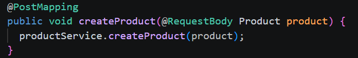
*controllerがBusiness Logicのコードを呼び出す*

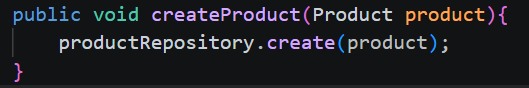
*Business LogicがRepositoryを呼び出す*

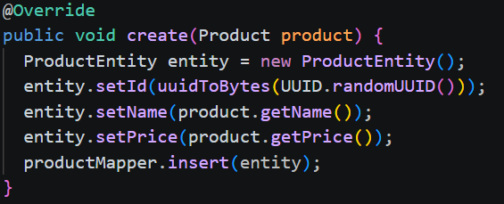
*Repositoryがオブジェクトを構築してMybatisを呼び出す*


### 3. 実装後の確認

実装が終わったら、`gradlew bootRun`を実行してアプリケーションを起動し、Spring Bootが正常に起動できることを確認します。ビルドが成功した場合は、次にBashのターミナルから`curl`コマンドを使ってHTTPエンドポイントをテストします。

確認の順番は次のとおりです。

1. コードがコンパイルできるか確認する。
2. `gradlew bootRun`でSpring Bootを起動する。
3. `curl`でPUTなどのHTTPリクエストを送信する。
4. レスポンスのステータスと本文を確認する。
5. エラーが発生した場合、Maiaが定めたエラー形式になっているか確認する。

エラーが発生した場合は、エラーメッセージが適切に整形されているかも確認します。原文では、例として`システムエラーが発生しました`というメッセージを確認しています。これは、エラーが発生したことをクライアントへ返す共通の表示内容が正しく使われているかを確認する作業です。

### 4. ProductのCRUD

Updateで行った手順と同じ考え方で、Productエンティティの残りのCRUDも実装できます。

- **Create**: 新しいProductを作成する
- **Read**: Productを取得する
- **Update**: 既存のProductを更新する
- **Delete**: Productを削除する

操作ごとにRepositoryインターフェースへ必要なメソッドを宣言し、RepositoryImplで具体的なデータベース処理へつなぎ、ApplicationServiceで必要なビジネスロジックを実行し、ControllerでHTTPエンドポイントを公開します。Updateの場合は`@PutMapping`を使っていますが、他の操作では対応するHTTPメソッドとControllerのマッピングを使います。

### 5. EntityとEntityExampleの使い分け

MyBatis Generatorが生成するコードでは、`Entity`と`EntityExample`は役割が異なります。

`Entity`は、データベースのテーブルの1行分のデータを表すオブジェクトです。Productの各フィールドに値を入れて、取得したデータを保持したり、INSERTやUPDATEで保存する値を表したりするときに使います。

`EntityExample`は、主に検索条件を組み立てるためのオブジェクトです。どの行を検索するか、または更新・削除の対象にするかを、条件として表現するときに使います。たとえば、特定のIDに一致するProductを対象にする条件を作る場合に利用します。

簡単に整理すると、次のようになります。

- `ProductEntity`: 操作するデータそのもの。テーブルの行に対応する
- `ProductEntityExample`: 操作対象を選ぶ条件。検索条件や対象行の指定に使う

更新処理では、通常「何を更新するか」を`EntityExample`で指定し、「どの値へ変更するか」を`Entity`で渡します。ただし、実際に利用できるメソッド名や条件の作り方は、MyBatis Generatorが生成した`Mapper`と`EntityExample`の内容に合わせて確認します。

業務ロジック側では、データベースに直接対応したEntityをそのまま使うのではなく、必要に応じて`Product`のようなドメインオブジェクトを使い、RepositoryImplで`ProductEntity`へ変換します。これにより、業務ロジックとデータベースの構造を分離できます。


---

## 7. VS Code拡張機能（フロントエンド開発用）

Vue.js アプリケーションを開発するために、Visual Studio Code へ以下の拡張機能をインストールする。

### Vue (Official)

Vue.js アプリケーションの開発に推奨されている拡張機能。

- `.vue` ファイル内のテンプレートとスクリプト両方に対して、型チェックと補完が効く。
- 詳細は[公式ドキュメント](https://vuejs.org)を参照。

### ESLint

TypeScript のコード品質を向上させるための拡張機能。リアルタイムでのコードのエラーを検出する機能を提供する。

- 未使用の変数や未定義の参照など、保存前に気づきにくいミスを保存時に検出できる。

### Stylelint

CSS のコード品質を向上させるための拡張機能。リアルタイムでのコードのエラーを検出する機能を提供する。

- プロパティの重複やセレクタの記述ミスなど、CSS特有の問題を検出する。

### Prettier - Code formatter

EditorConfig と連携して、統一したスタイルにコードを整形する機能を提供する。

- 保存時に自動整形されるため、インデントやクォートの統一をレビューで指摘する必要がなくなる。

### language-postcss

CSS で記述されたコードの可読性を向上させる機能を提供する。また、Stylelint と連携することで、CSS のコードのエラーを検出できる。

- ネスト構文を含むCSS(Sass風の書き方)でも、シンタックスハイライトが崩れずに機能する。

---

#### まとめ

これらの拡張機能を組み合わせることで、Vue.js のコンポーネント開発からスタイルの整形、コード品質のチェックまで、フロントエンド開発の一連の流れを効率化できる。


---

## 8. フロントエンドのコンフィグ

### 1. Node.js、npm、Vue.js、Viteの役割

フロントエンドの開発環境では、Node.js、npm、Vue.js、Viteがそれぞれ異なる役割を持ちます。

- **Node.js**: JavaScriptをブラウザの外、つまり自分のコンピューター上で実行するための実行環境です。Node.jsがあることで、npmやViteなどの開発用ツールを動かせます。
- **npm**: JavaScriptのパッケージマネージャーです。ライブラリや開発ツールをダウンロードし、バージョンや依存関係を管理します。npm自体がアプリケーションをビルドするのではなく、必要なツールをインストールして管理する役割を持ちます。
- **Vue.js**: 画面を作るためのJavaScriptフレームワークです。コンポーネントという単位で画面を分割し、データの変化に応じて画面を更新できます。
- **Vite**: Vueプロジェクトを開発中に実行したり、本番用のファイルへ変換したりするビルドツールです。

### 2. フロントエンド用ワークスペースの作成

最初に、バックエンドとは分けたフロントエンド用の作業ディレクトリを作成します。フロントエンドとバックエンドを別のプロジェクトとして管理すると、それぞれの依存ライブラリ、ビルド手順、責任範囲を分離できます。

次に、作業ディレクトリで次のコマンドを実行します。

```shell
npm init -y --init-type=module --init-private
```

このコマンドによって`package.json`が作成されます。`package.json`はNode.js/JavaScriptプロジェクトの設定ファイルで、Javaプロジェクトにおける`build.gradle`に近い役割を持ちます。プロジェクト名、使用するパッケージ、実行コマンドなどを記録するため、Vue.jsを追加する前に必要です。

### 3. Vueワークスペースの作成

ルートプロジェクトの中に、Vue.js用のワークスペースを作成します。この例では、Java側のプロジェクト名と合わせるため、Vueワークスペースの名前を`web`にします。

```shell
npm init -w web vue@latest .
```

このコマンドは、`web`ディレクトリをワークスペースとして初期化し、最新のVueプロジェクト用テンプレートを作成します。ここでいうワークスペースは、Vueのソースコードや個別の設定を持つ単位です。

作成後は、`frontend/web/package.json`を確認します。これはVueワークスペース個別の設定ファイルです。ルートの`package.json`が全体を管理し、`web/package.json`がVue側の依存関係やスクリプトを管理する構成になります。

Vueプロジェクトのファイル構造を理解するには、[MAIAのVue.js空プロジェクトのフォルダ構造ガイド](https://maia.alesinfiny.org/guidebooks/how-to-develop/csr/vue-js/folder-structure-of-blank-project/)を参照します。

### 4. Node.jsのバージョンと実行スクリプト

ルートとワークスペースの両方の`package.json`に`engines`ブロックを追加します。ここには、プロジェクトが想定するNode.jsやnpmのバージョンを記述します。両方のファイルでバージョン番号を一致させることが重要です。

バージョンを固定すると、開発者やCI環境ごとに異なるNode.jsが使われることを防ぎ、同じ条件でインストールやビルドを実行しやすくなります。

また、ガイドに従ってルートの`package.json`の`scripts`ブロックを変更します。`scripts`には、`npm run build`や`npm run lint`のような、プロジェクトで頻繁に使うコマンドに名前を付けて登録します。これは、チーム内で同じ手順を使うための慣習的な設定です。

### 5. ビルドとVueプロジェクトの設定

デプロイ用のビルドは次のコマンドで実行します。

```shell
npm run build
```

TypeScriptや`.vue`ファイルは、そのままではブラウザが直接理解できない部分があります。ビルドでは、それらをブラウザが実行できるJavaScript、HTML、CSSなどへ変換します。同時に、TypeScriptコンパイラ、Viteのバンドラー、プロジェクト全体の構造が正しく動作するかも確認します。

TypeScriptの設定方法、検証方法、開発用パッケージについては、次のガイドを参照します。

- [Vue.jsプロジェクト設定](https://maia.alesinfiny.org/guidebooks/how-to-develop/csr/vue-js/project-settings/)
- [Vue.jsのオプションパッケージ](https://maia.alesinfiny.org/guidebooks/how-to-develop/csr/vue-js/optional-packages/)

### 6. 静的解析とコード整形

静的解析とは、プログラムを実行しなくても、コードの書き方や潜在的な問題をツールで検査することです。コード整形は、インデントや改行などを自動的に統一することです。これらを設定すると、個人の書き方の違いによる不要な差分を減らし、バグになりやすいコードを早期に見つけられます。

#### `.editorconfig`

`.editorconfig`を見つけたら、ルートディレクトリへ移動し、ファイルの先頭に次を追加します。

```ini
root = true
```

これは、この`.editorconfig`をプロジェクト設定の最上位として扱うという意味です。

#### Prettier

`.prettierrc.json`をルートディレクトリへ移動し、JSONオブジェクトをJavaScriptモジュールへ変換します。ファイル末尾で設定を`export`し、ルート設定を他の設定から読み込めるようにします。

ワークスペース内の`.prettierrc.js`は残しますが、設定を重複して書かず、ルートの設定を読み込む内容に書き換えます。これにより、整形ルールを一か所で管理できます。

#### ESLint

`.eslint.config.ts`をルートディレクトリへ移動します。Vueファイルも解析できるように、`export default`の前で`configureVueProject`を呼び出します。また、設定ファイルの場所が変わるため、パスを解決できるように`parserOptions`ブロックを追加します。

さらに、ルートの`.eslint.config.ts`だけを対象とする専用の`tsconfig.json`を作成します。ESLintの設定ファイル自体もTypeScriptとして検査されるため、どのTypeScriptプロジェクトに属するかを明示する必要があります。

#### Stylelint

VueファイルとCSSを検査するため、Vueワークスペースで次を実行します。

```shell
npm install -D stylelint stylelint-config-standard stylelint-config-recommended-vue
```

その後、ルートに`.stylelintrc.js`を作成します。ワークスペース側にも`.stylelintrc.js`を置き、Prettierと同じようにルートの設定を読み込ませます。

ワークスペースから次のコマンドを実行して、CSSとVueファイルを自動修正します。

```shell
npx stylelint "**/*.{vue,css}" --fix
```

初期生成された`base.css`に`:root`ブロックが3つある場合、同じセレクターの重複としてエラーになることがあります。その場合は、重複している各ブロックの直前に無視用コメントを一つずつ追加します。自動的にすべてを無視するのではなく、既知の生成コードだけを対象にすることが重要です。

最後に、次のコマンドを`--fix`なしで実行し、問題が残っていないことを確認します。

```shell
npm run format
npm run lint
npx stylelint "**/*.{vue,css}"
```

設定ファイルをルートへ移動すると、ESLintが通常のTypeScriptプロジェクトに属さないJavaScript設定ファイルを型チェックできなくなる場合があります。その場合は、`eslint.config.ts`の`allowDefaultProject`へ各ファイルのパスを追加します。ワークスペース側のファイルには`web/`という接頭辞が必要で、ルート側のファイルにはファイル名だけを指定します。

新しい`tsconfig.json`の`include`に`eslint.config.ts`を追加した後は、そのファイルを`allowDefaultProject`から削除します。両方に登録すると競合する場合があります。`eslint.config.ts`を編集した後はESLintサーバーを再起動します。エディター上の警告表示は遅れることがあるため、最終的な判断は`npm run lint`の結果でも確認します。

### 7. メッセージ管理とVue I18n

画面に表示するメッセージをコンポーネントへ直接書くのではなく、Vue I18nを使って管理します。まず、Vueワークスペースで次を実行します。

```shell
npm install vue-i18n
```

`src`の下に`locales`フォルダを作り、その中に`en/`と`ja/`を作成します。それぞれの言語フォルダに、`messageList_xx.json`と`validationTextList_xx.json`を置きます。英語と日本語のファイルではキーを完全に一致させます。日本語側から推論されたデータの形が英語側にも適用されるため、キーが不足したり余分だったりするとTypeScriptの型エラーになります。

`locales/i18n.ts`では、両言語のJSONを読み込み、`ja`と`en`をキーにした`langPackage`オブジェクトへまとめます。`window.navigator.language`でブラウザの言語を確認し、対応していない言語の場合は英語へフォールバックします。その後、`createI18n`でi18nインスタンスを作成してexportします。`legacy: false`にすると、Composition API形式でi18nを利用できます。

ガイドにある`errorOccurred`は形式を示す例であり、実際に必要なメッセージ一覧そのものではありません。Java側の`messages.properties`と同じように、機能を実装しながらアプリケーションに必要なキーを追加します。

既存の`main.ts`を開き、次を追加します。

1. `./locales/i18n`からi18nインスタンスをimportする。
2. `app.use(i18n)`を追加する。

`app.use(i18n)`だけをコピーしてimportを忘れると、`cannot find name i18n`エラーになります。

コンポーネントから使う場合は、`@/locales/i18n`からi18nをimportし、`i18n.global`から`t`を取り出して、スクリプトやテンプレート内で`t('key')`を呼び出します。

### 8. 入力値の検証: vee-validateとZod

フォーム入力を検証するため、Vueワークスペースで次を実行します。

```shell
npm install vee-validate zod@^3 @vee-validate/zod vue-i18n
```

`@vee-validate/zod`は現時点でZod 4と互換性がないため、Zodはバージョン3に固定します。`validationTextList_ja.json`へ、`email`、`required`、`tooBig`、`tooSmall`、`invalidFormat`などの実際の検証メッセージキーを追加し、英語版にも同じキーを追加します。

`src/validation/validation-items.ts`を作成し、再利用可能なZodルールを返す関数を定義します。たとえば、メールアドレス、必須入力、必須メールアドレスのルールを作り、メッセージ本文はi18nから取得します。これにより、現在の言語に応じて検証エラーの文章も切り替わります。

フォームコンポーネントでは、次の流れで利用します。

1. 定義したルールからZodスキーマを作成する。
2. `@vee-validate/zod`の`toTypedSchema`で、vee-validateが扱えるスキーマへ変換する。
3. 変換したスキーマを`useForm`の`validationSchema`へ渡す。
4. 各入力に対して`useField`を使い、リアクティブな値と`errorMessage`を取得する。

ガイドにある完全なログインフォーム例は、この商品サンプルの範囲とは関係がないため省略します。メール、パスワード、確認用パスワード、生年月日、項目間の`refine`、グローバルなZodエラーマップなどの考え方は、実際のフォームを作るときに同じパターンで適用できます。

### 9. OpenAPI GeneratorによるAPIクライアント生成

フロントエンドがバックエンドからデータを取得し、画面へ表示するためには、APIを呼び出すコードが必要です。そこでOpenAPI Generatorを使います。

バックエンド設定では、SpringのアノテーションからAPIの機械可読な説明を自動生成する`springdoc-openapi`を利用しています。APIの説明は、通常次のURLで取得できます。

```text
http://localhost:8080/v3/api-docs
```

この説明を取得して、作業ディレクトリの`api-specification.json`として保存します。さらに、説明ファイルの場所と生成コードの出力先をOpenAPI Generatorへ伝えるため、`openapisettings.json`を作成します。

設定が終わったら、次のコマンドでクライアントコードを生成します。

```shell
npm run generate-client
```

OpenAPI Generatorは、API仕様の`schema`からTypeScriptの型を作り、各エンドポイントを呼び出すための関数も生成します。内部ではAxiosなどのHTTPクライアントが使われます。生成された関数を直接呼ぶとコードが複雑になりやすいため、Vueコンポーネントから呼び出しやすいように、手書きの`index.ts`をラッパーとして用意します。

TypeScriptでは、コンパイル時に変数やデータの形が分かっている必要があります。JavaScriptのように形が曖昧なまま実行するのではなく、APIの入力と出力の型をフロントエンド側でも一致させる必要があります。そのため、バックエンドが公開するAPI仕様から型と呼び出し関数を生成するOpenAPI Generatorを利用します。

### 10. フロントエンドのエラー処理

フロントエンドで発生するエラーを、単に画面へ直接表示するのではなく、種類や表示方法を統一して管理します。バックエンドから返されたAPIエラー、通信失敗、入力検証エラー、予期しない実行時エラーを区別すると、利用者には分かりやすいメッセージを表示し、開発者には原因を追跡できる情報を残せます。

### 11. 現時点で完成している範囲

ここまでで、ビルドツール、静的解析、メッセージ管理、入力値検証、実際のバックエンドへ接続されたOpenAPIクライアント、独自のエラー処理、イベントバスの土台が整います。

ただし、実際の画面UIはまだ存在しません。現段階では、どのコンポーネントもAPIを呼び出して取得データを画面へ表示していない状態です。次の段階では、これらの設定と生成されたクライアントを使い、Vueコンポーネント、画面レイアウト、ユーザー操作、APIデータの表示を実装します。


---

## 9. Vueの構築とリクエストの流れ

### `.vue`ファイルの読み方

`.vue`ファイルは、主に`script`、`template`、`style`という3つの部分で構成されます。それぞれ、おおむね次の役割を持ちます。

- `script`: JavaScriptまたはTypeScriptで、データや処理のロジックを記述する部分
- `template`: HTMLに相当し、画面に何を表示するかを記述する部分
- `style`: CSSに相当し、画面の見た目を指定する部分

基本的なルーティングを設定する場合は、`web/src/router/index.ts`を編集します。ルーティングとは、URLに応じてどの画面コンポーネントを表示するかを決める仕組みです。

注意点として、`<header>`セクションはデフォルトでは`<RouterView>`の外側にあります。そのため、初期状態のHello Worldメッセージなど、`<header>`に書かれた内容はすべての画面で表示されます。表示したくない場合は、`App.vue`からその内容を削除します。

ブラウザがキャッシュを使い続けてステータス304が表示される場合は、`vite.configuration.ts`を確認し、適切なプロキシ設定があるかを確認します。ステータス304は、サーバーが「内容は前回から変更されていないため、ブラウザのキャッシュを使ってよい」と伝えている状態です。

また、Axiosのオブジェクト全体を渡さず、必要な部分だけを渡すようにします。たとえば、レスポンスのデータだけが必要なら`.data`を使います。不要な情報まで次の層へ渡さないことで、各処理の責任とデータの形を明確にできます。

### フロントエンドからバックエンドへの実際の流れ

OpenAPIを通じてフロントエンドとバックエンドが正常に接続できた後の流れを、具体的に追ってみます。

`.vue`コンポーネントの`onMounted`が`productControllerApi()`を呼び出します。これは、OpenAPI Generatorが生成したTypeScriptクラスを包むラッパー関数です。生成元のクラスは、バックエンドのspringdoc-openapiが公開するエンドポイントから手動で取得した`api-specification.json`を読み取って作られています。

`api-specification.json`には、バックエンドが提供するAPIの一覧と、それぞれのAPIが受け取るデータや返すデータの定義が記録されています。ここでいう`schema`は、データの形を表す設計図です。たとえば、ユーザーが持つ`id`、`name`、`email`のような項目と、それぞれのデータ型を定義します。OpenAPI Generatorは、この`schema`をTypeScriptの型へ変換するため、フロントエンドで扱うデータの形を手作業で何度も書き直す必要がありません。

一方、`path`はAPIのURLと、そのURLで利用できるHTTPメソッドなどを表します。OpenAPI Generatorは`path`から、どのエンドポイントへどのようなリクエストを送るかを実装したTypeScriptのAPI呼び出し関数を生成します。つまり、`schema`は「どのようなデータか」を定義し、`path`は「どこへ、どのようにアクセスするか」を定義します。

生成コードは自動生成されるため、そのままでは複雑に見えることがあります。そこで、手書きの`index.ts`をラッパーとして使い、Vueコンポーネントからは`index.ts`の分かりやすい関数だけを呼び出す構成にします。画面上で利用者がVueコンポーネントを操作すると、コード上ではこの関数を通じて自動生成されたAPI関数が実行され、最終的にHTTPリクエストが送信されます。

生成されたクラスのメソッドはAxiosを使って実際のHTTPリクエストを送信します。リクエストはまずViteの開発サーバーへ到達し、Viteのプロキシ設定によって実際のバックエンドのポートへ転送されます。Spring Bootは、受け取ったリクエストを`ProductController`内の対応する`@GetMapping`メソッドへ振り分けます。返されたデータは、同じ経路を逆向きに通ってフロントエンドへ戻ります。

つまり、画面上の操作は、次のような呼び出しの連鎖になります。

`Vueコンポーネント` → `生成されたAPI関数` → `Axios` → `Viteのプロキシ` → `Spring Boot` → `ProductController`

### `vite.config.ts`の役割

`vite.config.ts`は、Viteの動作を設定するファイルです。特にフロントエンドからバックエンドへリクエストを転送するプロキシを設定すると、開発中でもフロントエンドとバックエンドを連携させられます。

### HTTPリクエストがデータベースを変更するまで

HTTPリクエスト、Javaオブジェクト、ビジネスロジックのデータ、SQL、データベースの値は、それぞれ異なる役割と形式を持ちます。そのため、HTTPリクエストが最終的なデータベースの変更になるまでには、複数の層を順番に通過します。

処理全体を1つの場所にまとめることも技術的には可能ですが、それでは各部分の責任が混ざり、変更やテストが難しくなります。`Dependency Inversion`の考え方に沿って、処理を役割ごとの層に分けます。ここでは、VueからPUTリクエストを送り、ユーザーの情報を更新する場合を例にします。

1. **Spring Securityによる認証**

	Spring Securityは、HTTPリクエストの`Authorization`ヘッダーを読み取ります。その認証情報を使ってデータベースなどを確認し、リクエストを送った利用者が正しく認証されているかを判断します。認証に失敗した場合、通常はこの先の処理へ進みません。

2. **`DispatcherServlet`への振り分け**

	認証に成功すると、SpringはHTTPリクエストを`DispatcherServlet`へ渡します。`DispatcherServlet`はSpring Frameworkに組み込まれたクラスで、認証後のリクエストを受け取り、適切なControllerメソッドへ振り分ける入口の役割を持ちます。

	Springアプリケーションの起動時には、Springが`@RestController`の付いたクラスを調べます。そして、どのURLやHTTPメソッドの呼び出しを、どのControllerメソッドに対応させるかという内部的な対応表を作ります。`DispatcherServlet`はリクエストを受けた後、この対応表を使って正しいメソッドを呼び出します。

3. **Controllerによる入力の受け取り**

	`DispatcherServlet`は、URL、クエリパラメータ、リクエスト本文などから必要な値を取り出し、Controllerメソッドへ渡します。Controllerメソッドの戻り値はHTTPレスポンスへ変換されます。これが、`@RestController`がAPIの戻り値をHTTPレスポンスとして返す仕組みです。

	Controllerは、すべての業務ルールを自分で実行する場所ではありません。入力を受け取り、必要なBusiness LogicをApplicationServiceへ依頼する入口として使います。

4. **ApplicationServiceによるビジネスルールの実行**

	Controllerから呼び出されたApplicationServiceは、アプリケーション固有の業務ルールに従って処理を実行します。たとえば、「この利用者は更新できるか」「更新前に必ず検証すべき値は何か」といった、人間が設計したルールをここで適用します。

	ApplicationServiceはデータベースの詳細を直接扱うのではなく、必要なデータ操作をRepositoryへ依頼します。これにより、業務ルールとデータ保存の仕組みを分離できます。

5. **RepositoryImplによるデータ形式の変換**

	RepositoryImplは、ビジネスロジック層で扱っているデータを、データベース層が保存できる形式へ変換します。その後、整形したデータをMyBatisへ渡します。

	ApplicationServiceがデータベースの具体的な技術を直接知る必要がないように、Repositoryという境界を置いています。上位のビジネスロジックが下位のデータベース技術に強く依存しないようにする点で、これは`Dependency Inversion`の考え方に対応します。

6. **MyBatisによるSQL実行**

	MyBatisは、Java側で受け取ったデータをSQLのパラメータとして扱い、データベースを更新します。ここで初めて、アプリケーション内のデータがSQLとして実行され、実際のDBの値の変更になります。

この流れを一方向にまとめると、次のようになります。

`Vueコンポーネント` → `自動生成されたAPI関数` → `Axios` → `HTTPリクエスト` →　`Vite プロキシ` → `Spring Security` → `DispatcherServlet` → `Controller` → `ApplicationService(ビジネスロジック)` → `RepositoryImpl（データベース向け）` → `MyBatis` → `SQL` → `データベース`

この層分けの重要な点は、単に処理を多くのファイルへ分散することではありません。それぞれの層が「何を決める責任を持つか」を明確にし、変更の影響範囲を小さくすることです。たとえば、データベース技術を変更しても、業務ルールを担当するApplicationServiceまで変更せずに済む構造を目指します。


---

## 10. Spring Securityについて

### 1. Spring Securityの導入

MAIAではSpring Securityが推奨されています。そのため、このサンプルアプリケーションにもSpring Securityを導入します。

まず、`web/gradle.build`の依存関係ブロックに次を追加します。

```groovy
implementation 'org.springframework.boot:spring-boot-starter-security'
```

依存関係とは、アプリケーションが利用する外部ライブラリのことです。この設定によって、WebアプリケーションでSpring Securityを使えるようになります。

### 2. H2データベースとMyBatis Generator

最初に永続H2データベースを操作します。永続データベースを使うのは、MyBatis Generatorを一度実行して、後でフロントエンドとバックエンドを接続するために必要なAPI関連のコードを生成するためです。そのため、H2 Consoleを開きます。

次に、インメモリH2データベースを設定します。対象は`web\src\main\resources\schema.sql`です。永続データベースで実行したものとまったく同じSQLコマンドを実行します。

その後、`mybatisGeneratorConfig.xml`を探し、次の設定を追加します。

```xml
<table schema="" tableName="users" domainObjectName="UserEntity" mapperName="UserMapper">
  <property name="mapUnderscoreToCamelCase" value="true" />
</table>
```

この設定は、`users`テーブルから`UserEntity`と`UserMapper`を生成するようMyBatis Generatorへ指示します。`mapUnderscoreToCamelCase`を`true`にすると、アンダースコアを含むデータベースの名前を、Javaでよく使うキャメルケースへ対応させます。

この時点で、永続H2データベースを完全に終了しておきます。最後に、次のGeneratorを実行します。

```shell
./gradlew infrastructure:runMyBatisGenerator
```

MyBatis Generatorが実際に動作したか確認するため、`infrastructure`の下を確認します。`UserEntity.java`と`UserMapper.java`が生成されていれば、この例ではMyBatisの生成処理が成功しています。

### 3. UserDetailsServiceとSecurityConfig

次に、`UserDetailsServiceImpl.java`と`SecurityConfig.java`を作成します。

`SecurityConfig.java`が必要なのは、Spring Securityがデフォルトではすべての場所を保護するためです。開発中にすべての場所を閉じてしまうと、必要な確認までできなくなります。`SecurityConfig.java`では、どのURLを公開し、どのURLを保護するかを定義できます。公開する場所には`.permitAll()`を使います。

`UserDetailsServiceImpl.java`は、ログインを試みたユーザーの認証情報が有効かどうかを確認するためのクラスです。Spring Securityがユーザー名を使ってこの処理を呼び出し、ユーザー情報をデータベースから取得します。

### 4. 初期ユーザーの作成

アプリケーションへアクセスできるようにするには、最初にログイン用の初期ユーザー、つまりseed userを用意します。パスワードを設定し、ハッシュ化された値を作成して、まず端末へ出力します。

`WebApplication.java`で、次のコードを実行します。

```java
System.out.println(new org.springframework.security.crypto.bcrypt.BCryptPasswordEncoder().encode("password123"));
```

端末に表示されたハッシュ値をコピーし、`data.sql`の`本物のHASH`の部分へ貼り付けます。

```sql
INSERT INTO users (id, username, password) VALUES
(RANDOM_UUID(), 'admin', '本物のHASH');
```

ここで保存するのは、元の`password123`そのものではなく、BCryptで変換されたハッシュ値です。元のパスワードをそのままデータベースへ保存しないことが重要です。

### 5. Spring Securityの動作確認

Spring Securityが意図どおりに動作しているか確認するため、必要に応じて次のように`curl -v`を使います。URLの`...`は実際に確認したいエンドポイントへ置き換えます。

```shell
curl -v http://localhost:8080/...
```

- `HTTP/1.1 200`: アクセスが許可された
- `HTTP/1.1 401`: 認証が必要で、アクセスが制限された

### 6. UserのCRUDとパスワードの扱い

UserエンティティのCRUDは、Productエンティティと同じような形で作り直せます。ただし、重要な違いがあります。Userの`password`フィールドは、保存する前に`BCryptPasswordEncoder`でハッシュ化する必要があります。

UserのCRUDはSpring Securityとも関係するため、`application-core/build.gradle`にSpring Securityの暗号化機能を記述します。

```groovy
dependencies {
  implementation 'org.springframework.boot:spring-boot-starter'
  implementation 'org.springframework.boot:spring-boot-transaction'
  implementation project(':system-common')

  implementation 'org.springframework.security:spring-security-crypto'

  testImplementation 'org.springframework.boot:spring-boot-starter-test'
}
```

`build.gradle`を変更したため、次のコマンドを実行して`application-core`を再ビルドします。

```shell
gradlew application-core:build
```

### 7. ユーザー情報と認証情報の確認

Spring SecurityとVue.jsを使ってユーザーのログイン認証を実装するときは、認証情報を確認する役割がエンドポイントの業務ロジックではなく、Spring Securityにあることを理解する必要があります。Spring Security自身がデータベースを調べ、認証情報が正しいかどうかを判断します。

Spring Securityは、ユーザー情報が正しいと確認すると、そのユーザーの情報を`Security Context`へ保存します。認証済みのユーザー情報は、`Principal principal`を使って取得できます。Spring Securityが認証時にすでにデータベースを確認しているため、認証後に同じユーザー情報を再度検索する処理を省略できる場合があります。

基本的な通信の流れは次のとおりです。

1. Axiosで、ユーザー名とパスワードを含むHTTPリクエストを指定されたエンドポイントへ送信します。
2. `vite.config.ts`の設定により、そのリクエストは`localhost:8080`へ転送されます。
3. Spring SecurityがControllerのコードより先にリクエストを処理します。
4. Spring Securityは`loadUserByUsername(username)`を呼び出します。
5. その処理が実際のデータベース検索を行い、暗号化されたハッシュを含むユーザーオブジェクトを返します。
6. 認証に成功すると、Spring SecurityはControllerの処理を許可します。
7. Controllerはユーザー名とパスワードの平文を返し、そのログイン情報をVueプロジェクト全体で使えるようにPiniaへ保存します。

### 8. フロントエンドからCRUDを利用する場合

フロントエンドからCRUDを利用するには、まず`SecurityConfig.java`を変更します。`.requestMatchers().permitAll()`へ`org.springframework.http.HttpMethod.GET`のような引数を追加し、どのHTTPメソッドを公開し、どのHTTPメソッドを非公開にするかを指定します。

つまり、URLだけでなくHTTPメソッドの種類も公開範囲の判断材料になります。GETは公開し、更新や削除に使う別のHTTPメソッドはログイン済みユーザーだけに許可する、といった設定を定義できます。実際にどのメソッドを公開するかは、`SecurityConfig.java`に書かれた設定に従います。

以前、OpenAPI Generatorを使って`api-specification.json`からTypeScriptの型とAPI呼び出し関数を生成しました。フロントエンドのGUIは、これらのAPI呼び出し関数を使ってバックエンドへアクセスします。

ログイン済みユーザーだけに特定のHTTPリクエストを許可したい場合は、そのリクエストへ認証情報を付ける必要があります。認証情報は、Axiosオブジェクトが実際にHTTPリクエストを送信するタイミングで、毎回添付されるようにします。


---

## 11. アプリをテストする（単体テスト・結合テスト・CI/CD）

### 単体テスト

JUnitはJavaコードを自動テストするためのライブラリ。ただし個々のテスト関数自体は手書きする必要があり、JUnitが自動で書いてくれるわけではない。Javaコードの視点だけでテストするため、HTTPもサーバーも不要。

単体テストは、業務ロジック・web・infrastructureをそれぞれ独立して確認するもの。業務ロジックをテストする場合、Repositoryなど本番で使う依存をfakeに差し替えて、対象の層だけを孤立させてからテストする。

層ごとの実際のやり方：

- **business logic (application-core)**：`ProductRepository`などのinterfaceに対して手書きのfake実装(`FakeProductRepository`)を用意し、それを渡して単体テストする
- **infrastructure**：ここはそもそも実データベースとの通信そのものが対象なので、軽量な結合テストとして扱う。MyBatis構成では`@DataJpaTest`は使えない（JPA専用のアノテーションのため）。代わりに専用の`@SpringBootTest`用アプリ＋テスト用の`schema.sql`／インメモリH2を用意する
- **web**：`@SpringBootTest` ＋ `@AutoConfigureMockMvc`を使う。実際のネットワークソケット通信は一切発生せず、同じJVMプロセス内(in-process)で完結する。`MockMvc`が偽のリクエストオブジェクトを組み立て、それを実際の`DispatcherServlet`に直接渡すことで、ルーティングやController自体の処理は本物のまま検証できる。当初`@WebMvcTest`で試したが、`@ComponentScan`の範囲が広いため無関係なBean（UserController等）まで読み込もうとし、その都度モックが必要になったため断念した. （spring boot バージョンによりアノテーションの分け使いが異なります）

実行コマンド：`./gradlew web:test`
対応する`/test`配下にある、`@Test`が付いたメソッドを自動的にすべて実行する。

#### 実際にハマった点 

- Spring Boot 4.1.1では`@MockBean`→`@MockitoBean`、`@WebMvcTest`のパッケージ自体が変更されている（`org.springframework.boot.webmvc.test.autoconfigure`）
- `@WebMvcTest`は、`@ComponentScan`の範囲が広いと関係ないController（例：`UserController`）のBeanまで読み込もうとし、その都度モックが必要になり収拾がつかなくなる。Maia公式ドキュメントでも結合テストは`@SpringBootTest`＋実際のインメモリH2を使う方式が前提なので、そちらに合わせた
- テスト用の`schema.sql`は複数のテストクラスから再実行されることがあるため、`DROP TABLE IF EXISTS`を先頭に付けて再実行に強くしておく

### 結合テスト／APIテスト

curlで実際にHTTPを叩いて確認する。最低限、次の4点を確認する：status code、response body、response header、DBへの副作用。

実際には`test.sh`という自作スクリプトにcurlコマンドを関数化してまとめてあり、毎回手打ちせずに済むようにしている。

```bash
BASE_URL="http://localhost:8080/api/products"

display_all(){
    curl -s "$BASE_URL"
}
create_product(){
    local name="$1"
    local price="$2"
    curl -s -X POST "$BASE_URL" -H "Content-Type: application/json" \
      -d "{\"name\":\"$name\", \"price\": $price}"
}
update_product(){
    local id="$1"
    local name="$2"
    local price="$3"
    curl -s -X PUT "$BASE_URL/$id" -H "Content-Type: application/json" \
      -d "{\"name\":\"$name\", \"price\": $price}"
}
delete_byId(){
    local id="$1"
    curl -s -X DELETE "$BASE_URL/$id"
}
```

Spring Security導入後は、認証あり／なしの両方をstatus codeで確認する関数も追加した：

```bash
login_test(){
    local username="$1"
    local password="$2"
    curl -s -o /dev/null -w "%{http_code}\n" -u "$username:$password" "http://localhost:8080/v3/api-docs"
}
```

`200`なら認証成功、`401`なら認証失敗。正しいパスワードと間違ったパスワードの両方を試し、正しく分かれることを確認する。

結合テスト（Integration Test）には @SpringBootTest を使用します。
@SpringBootTest は実際の Spring コンテナを起動し、H2 インメモリデータベースや MyBatis も実際に動作する状態でテストを行います。

Repository層とController層のテストでは @SpringBootTest を使用しているため、これらは結合テストです。

Infrastructure層では、実際のデータベースと接続して動作を確認することが重要です。

Web層では、DispatcherServlet が実際に起動した状態でリクエストを処理できるかを確認する必要があります。そのため、実際のWeb環境に近い形でテストを実行します。

### CI/CD

CI：コードを変更するたびに、自動でビルドやテストを行います。
CD：CIが成功したら、自動でサーバーにコードを反映します。
GitHub Actionsを使うとCIを実装できます。コードを変更するたびに、GitHub Actionsが一時的な仮想マシンを作成し、その中でビルドやテストを自動実行します。
まずはバックエンドとフロントエンドのterminalの中に `git init` commandを使うと、このプロジェクトをgit repositoryに変更します。
その後、`.gitignore`を作ります。`npm install`と`./gradlew build`から自動生成のファイルは、コミットする際に自動無視される。
具体的に、`.gitignore`は以下です
```bash
demo/demo/build/
demo/demo/**/build/
demo/demo/.gradle/
demo/demo/**/*.class
demo/demo/**/hs_err_pid*.log

frontend/**/node_modules/
frontend/**/dist/
frontend/**/.vite/
```
プロジェクトの状態を確認して、良かったら最初のコミットをローカルでやります。
```bash 
git init
git add . 
git commit -m "メッセージ"
```
その後、GitHub WebUIにrepositoryを作ります。
そして、GitHub repositoryと自前のアプリを接続できます。
```bash
git remote add origin https://github.com/yourusername/maia-sample-app.git
git branch -M main
git push -u origin main
```
Github repositoryにプッシュします。
GitHub Actionのケースには
GitHub Actionsで、pushのたびに`./gradlew build`（テストを含む）と`npm run build`を自動実行する。ローカルで確認し忘れても、pushした時点で自動的にビルド・テストが行ったほしいです。
GitHub Actionsを指示するためにci.ymlをつくります
`.github/workflows/ci.yml`：

```yaml
name: CI

on:
  push:
    branches: [main]
  pull_request:
    branches: [main]

jobs:
  backend:
    runs-on: ubuntu-latest
    defaults:
      run:
        working-directory: demo/demo
    steps:
      - uses: actions/checkout@v4
      - uses: actions/setup-java@v4
        with:
          java-version: '21'
          distribution: 'temurin'
      - run: chmod +x gradlew
      - run: ./gradlew build

  frontend:
    runs-on: ubuntu-latest
    defaults:
      run:
        working-directory: frontend
    steps:
      - uses: actions/checkout@v4
      - uses: actions/setup-node@v4
        with:
          node-version: '22'
      - run: npm install
      - run: npm run build -w web
```
`run`の部分のコマンドは、本当にGitHubからの仮想マシンで実行します。
ここに、`./gradlew build`を使いますから、`test`も含まれています。

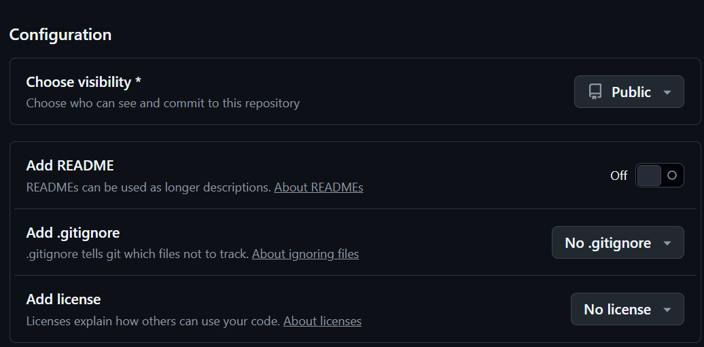
.gitignoreとライセンスは不要です。
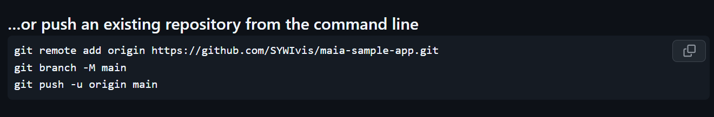
以上のコマンドは、自前のアプリのterminalに実行すれば、先に作ったリポジトリを接続とプッシュできます。
GitHubのAction GUIから、状態を直感的に確認できます
<br>
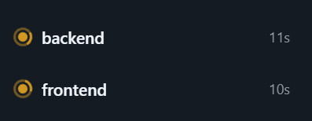<br>
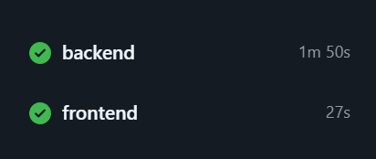<br>

CDには、まずサービスを選んで、アプリをdeployします。


---

## 12. 用語総まとめ（付録）

---

### 1. アーキテクチャと設計の基本

#### 依存関係
- あるモジュールやクラスが、別のモジュールやクラスを利用している状態。
- 例: Service が Repository を使うなら、Service は Repository に依存している。
- 依存が強すぎると、変更が広がりやすくなり、保守しにくくなる。

#### 依存関係の逆転
- 上位の層が、下位の技術詳細に直接依存しないようにする設計思想。
- 例: 業務ロジックが DB の実装や SQL の細部を知りすぎないようにする。
- 目的は、技術変更が業務ロジックへ波及しにくくすること。
- これは現代のバックエンド設計で非常に重要な基本原則。

#### レイヤー / 層
- システムを責務ごとに分けた構造。
- 典型例:
  - web: HTTP の入口
  - application-core: 業務ロジック
  - infrastructure: DB や外部接続
  - system-common: 共通機能
- 層を分けることで、役割が明確になり、変更やテストがしやすくなる。

#### 責務
- そのクラスやモジュールが「何を担当するか」。
- 例: Controller は HTTP の入口、Repository は DB の窓口、Service は業務処理の中心。
- 責務が曖昧だと、コードが混ざり、保守が難しくなる。

#### 境界
- 役割が切り分けられる線。
- 例: Controller と Service の境界、DB と業務ロジックの境界。
- 境界が明確だと、変更の影響範囲を小さくできる。

#### ドメインオブジェクト
- 業務上の概念を表すオブジェクト。
- 例: Product, User, Order など。
- データベースの構造そのものではなく、「この業務で意味のある概念」を表す。

#### DTO
- Data Transfer Object。
- 画面や API でやり取りするデータを格納するためのオブジェクト。
- DB のテーブルの構造そのものをそのまま業務ロジックに持ち込まないために使うことが多い。

#### Entity
- DB と密接に結びついたデータ表現。
- テーブルの行とほぼ対応する。
- DB と直接やり取りする層で使うことが多い。

#### Domain Object
- 業務領域を表すオブジェクト。
- Entity をそのまま使うのではなく、業務上の意味を持つオブジェクトとして独立させる。
- 例: ProductEntity は DB 向け、Product は業務ロジック向け。

---

### 2. Spring / Java の基礎概念

#### Spring Boot
- Java で Web アプリを作るための土台。
- 設定や起動周りを簡単にし、開発者が業務ロジックに集中できるようにする。
- たいていのアプリは Spring Boot を起点として構成される。

#### Spring Framework
- Java アプリケーションの基盤を提供するフレームワーク。
- DI、AOP、Web MVC、セキュリティなどを提供する。
- Spring Boot はその上でより使いやすくしたもの。

#### Dependency Injection
- 依存するオブジェクトを、自分で new せずに外から注入する仕組み。
- 例: Service が Repository を使うとき、Service 自身が Repository を作るのではなく、Spring が渡してくれる。
- 目的は、結合度を下げてテストしやすくし、実装を差し替えやすくすること。

#### Bean
- Spring が管理するオブジェクト。
- @Component, @Service, @Repository, @Controller などで登録される。
- Spring が依存解決やライフサイクル管理を行う対象。

#### アノテーション
- クラスやメソッドに付ける注釈。
- Spring はこの注釈を見て、どのようにクラスを扱うかを判断する。
- 例: @RestController, @Service, @Repository, @Autowired, @Mapper

#### @RestController
- HTTP リクエストを受け取り、JSON のレスポンスを返す Controller。
- メソッドの戻り値はそのまま HTTP レスポンスとして返ることが多い。
- これがないと、Spring は HTML のテンプレートとして解釈することがある。

#### @Controller
- 通常、Web の入口として HTTP リクエストを受け取る。
- @RestController は @Controller に REST の返却を追加したものに近い。

#### @Service
- 業務ロジックを置く層。
- 例: 商品更新のルールや、ユーザー認証のロジック。
- Controller は HTTP の処理に集中し、Service が業務を担当する。

#### @Repository
- DB とのやり取りを担当する層。
- 例: findById, save, update, delete の実装。
- DB の詳細と業務ロジックの境界を作る役割を持つ。

#### Interface
- 何を提供するかを定義した契約。
- 実装の詳細は別クラスに任せる。
- 例: ProductRepository は「商品に関する操作を提供する」という契約。

#### Implementation
- そのインターフェースを実際に実装するクラス。
- 例: ProductRepositoryImpl は Repository の具体的な処理を実装する.

#### Mapper
- SQL と Java オブジェクトをつなぐ役割。
- MyBatis の文脈では、DB の操作メソッドを定義するもの。
- 例: UserMapper, ProductMapper

#### MyBatis
- Java から SQL を扱いやすくするフレームワーク。
- Java オブジェクトと DB のテーブルの対応を比較的自然に扱える。
- SQL を文字列で埋め込みながら、データアクセスを抽象化する。

#### MyBatis Generator
- DB のテーブル定義をもとに、Entity や Mapper を自動生成するツール。
- 生成対象は、実装の定型コードを減らすため。
- これは実行時のライブラリではなく、開発時に使うコード生成ツール。

#### Mapper XML
- SQL を記述する XML。
- Mapper の実装詳細を埋める場所。
- 例: insert, select, update, delete の SQL を定義する。

#### Lombok
- Java の定型コードを自動生成するライブラリ。
- getter, setter, constructor などを自動生成して、コード量を減らす。
- 例: @Data, @Getter, @Setter

#### Gradle
- Java / Kotlin / Spring 系プロジェクトのビルドと依存関係管理ツール。
- build.gradle を読み取り、ライブラリやモジュールの依存関係を管理する。
- Maven と似た役割だが、構成や書き方が違う。

#### build.gradle
- Gradle の設定ファイル。
- どのライブラリを使うか、どのサブプロジェクトを依存するかなどを定義する。

#### Component Scan
- Spring がどのパッケージを検索して Bean として登録するかを決める仕組み。
- ルートの構成が複雑だと、スキャン対象が不足して起動に失敗することがある。

#### Mapper Scan
- MyBatis の Mapper を Spring が検出できるようにする設定。
- @ComponentScan だけでは足りないことがあり、Mapper 専用の設定が必要になる。

#### Bean の登録とスキャン
- Spring はクラスを見つけて、必要なものを自動で管理する。
- ただし、プロジェクト構成がマルチプロジェクトになると、見つけられないことがある。

---

### 3. HTTP / API / Web の基本概念

#### HTTP
- HyperText Transfer Protocol。
- ブラウザやアプリがサーバーと通信するためのルール。
- URL のアクセス先と method で何をしたいかを伝える。

#### Request
- クライアントからサーバーへ向けた要求。
- URL, header, body などを含む。

#### Response
- サーバーがクライアントへ返す結果。
- 例: JSON, HTML, エラーコード。

#### Endpoint
- API のアクセス先。
- 例: /products, /users/login

#### GET
- データを取得するためのメソッド。
- 例: 商品一覧を読む。

#### POST
- 新しいデータを作成するメソッド。
- 例: 新しい商品を登録する。

#### PUT
- 既存データを更新するメソッド。
- 例: 商品情報を更新する。

#### DELETE
- データを削除するメソッド。
- 例: 商品を削除する。

#### REST
- Representational State Transfer.
- HTTP を使ってリソースを扱う設計思想。
- URL と HTTP method でリソースの操作を表現する。

#### Controller
- HTTP の入口で、URL とビジネスロジックを結ぶ役割。
- 例: ProductController が /products のリクエストを受ける。

#### DispatcherServlet
- Spring が受け取った HTTP リクエストを適切な Controller に振り分ける役割。
- 実際には Spring の内部ルーティング機構の中心。

#### @GetMapping
- GET リクエストに対応する URL を指定するアノテーション。
- 例: @GetMapping("/products")

#### @PostMapping
- POST を扱う API の定義。

#### @PutMapping
- PUT を扱う API の定義。

#### @DeleteMapping
- DELETE を扱う API の定義。

#### JSON
- JavaScript Object Notation.
- オブジェクトを文字列で表す形式。
- API ではよく使われる。他の言語でも扱いやすい。

#### Axios
- フロントエンドから HTTP リクエストを送るライブラリ。
- Vue から API を呼ぶときによく使う。

#### Proxy
- 何かを中継して別の場所へ委譲する仕組み。
- Vite では、ブラウザのリクエストを Spring Boot のローカルサーバーへ転送するために使う。

#### Vite
- フロントエンド開発用のビルド・実行ツール。
- 開発中のローカルサーバーとプロキシを管理する。

#### OpenAPI
- API の仕様を定義し、共有するための標準。
- API の URL, 入出力, 説明, バリデーションのルールを記述する。

#### api-specification.json
- API の設計書を JSON 形式で保存したもの。
- フロントとバックエンドの間の共通契約として使う。

#### springdoc-openapi
- Spring の Controller を解析して OpenAPI の仕様を生成する仕組み。
- これによって API 仕様を自動生成できる。

#### OpenAPI Generator
- OpenAPI 仕様書から TypeScript の型や API 呼び出しコードを生成するツール。
- フロントエンド側の型安全性を保ちながら、API を呼び出しやすくする。

#### TypeScript
- JavaScript に型を導入した言語。
- API の返却形式や引数の形を明示できるので、実行前にミスを防ぎやすい。

#### 生成コード
- 手で書くのではなく、ツールが自動で作るコード。
- OpenAPI Generator のようなツールは生成コードを作る。

---

### 4. データベースとデータモデル

#### Schema
- DB の設計図。
- テーブル名、列名、型、制約などが入る。

#### H2
- Java で使いやすい軽量のインメモリまたはファイルベースの DB。
- 開発中に使いやすい。

#### インメモリ DB
- 稼働中のメモリ上にデータを保存する DB。
- アプリ終了時に消える。
- 開発やテスト向き。

#### 永続 DB
- ファイルや外部ストレージにデータを保存する DB。
- アプリが止まってもデータが残る。

#### MyBatis Generator で作る Entity
- テーブルの各列に対応する Java のオブジェクト。
- DB の列と Java のフィールドが対応する。

#### ProductEntity
- products テーブルに対応する Entity。
- DB の構造に近いオブジェクト。

#### Product.java
- 業務ロジックで使うドメインオブジェクト。
- DB の構造に依存しない。

#### RepositoryImpl
- Repository の実体実装。
- DB にアクセスして、Entity と Domain Object の変換を担当する。

#### SQL
- データベースに対する問い合わせや更新の言語。
- SELECT, INSERT, UPDATE, DELETE などがある。

#### JDBC
- Java から DB と通信するための標準 API。
- MyBatis は内部的に JDBC を使うことが多い。

#### Query / select / update
- query: データ取得の要求。
- select: 条件に合うデータを読み取る。
- update: 既存データを変更する。

#### Example / Criteria
- 検索条件や更新対象条件を表現するオブジェクト。
- 例: id が 1 のデータだけを更新したい

#### 1 行 / レコード
- テーブルの 1 行に相当する単位。
- 1 行のデータを表すオブジェクトが Entity など。

---

### 5. セキュリティの基本

#### 認証
- 「その人が本当に本人か」を確認すること。
- 例: username と password の照合。

#### 認可
- 「その人にその操作を許可してよいか」を判断すること。
- 例: 管理者だけ削除できる。

#### Spring Security
- Java アプリの認証・認可やセキュリティ制御を扱う仕組み。
- Controller の前に介入して、アクセス制御を行うことがある。

#### Security Context
- 認証済みユーザー情報を保持するコンテキスト。
- そのユーザーがログイン中かどうかの状態を保持する場所。

#### Principal
- 現在認証済みのユーザーそのもの。
- 例: 現在のログインユーザーを扱うオブジェクト。

#### BCryptPasswordEncoder
- パスワードをハッシュ化して保存する仕組み。
- パスワードをそのまま DB に保存しないための基本手段。

#### ハッシュ化
- 元の値を元に戻せない形式に変換すること。
- パスワード保存で重要。

#### permitAll()
- その URL へのアクセスをどのユーザーにも許可する設定。
- 開発時に公開したい API に使う。

#### 401 Unauthorized
- 認証ができておらず、アクセスが拒否された状態。
- 一般的にはログインが必要。

#### 200 OK
- 正常に処理が成功した状態。

#### Authorization header
- HTTP のヘッダの一種。
- 認証情報を載せる場所。

#### ログイン済みユーザーの情報を保持する
- Spring Security が認証後にユーザー情報を保持し、後の処理で再度 DB を探す手間を減らす。

---

### 6. フロントエンドの基本

#### Vue
- UI を構築するフレームワーク。
- 画面コンポーネントや状態管理を扱う。

#### component
- 画面の部品単位。
- 例: 商品一覧、ログインフォーム、ボタン。

#### template
- HTML に相当する画面描画部分。

#### script
- Vue でロジックやデータ定義を行う部分。

#### style
- CSS に相当する見た目の定義。

#### Router
- URL に応じてどの画面を表示するかを決める仕組み。

#### Pinia
- Vue でアプリ全体の状態を管理するライブラリ。
- 例: ログインユーザー情報や共通データを保存する。

#### onMounted
- コンポーネントが画面に描画される直後に実行される処理。
- API を呼ぶときによく使う。

#### API client
- Backend の API を呼ぶためのコード。
- OpenAPI Generator で生成される。

#### wrapper
- 生成コードをもっと簡単に呼べるようにした小さなラッパー関数。

#### event bus
- あるコンポーネントから別のコンポーネントへイベントを伝える仕組み。
- 使いどころは限られるが、状態共有の簡略化に使える。

#### i18n
- Internationalization.
- 画面の文言を言語ごとに切り替える仕組み。

#### vee-validate
- フォームバリデーションを簡単に扱うライブラリ。

#### zod
- スキーマ定義とバリデーションのためのライブラリ。
- 例: email は必須、長さが制限内か.

#### validation
- 入力値が正しいかどうかを確認する仕組み。

---

### 7. 開発ツールと品質管理

#### Node.js
- JavaScript を PC 上で実行するランタイム。
- npm, Vite, Vue 開発の基盤。

#### npm
- Node.js のパッケージ管理ツール。
- 依存関係のインストールと管理を担当する。

#### package.json
- Node.js プロジェクトの設定ファイル。
- 依存関係、スクリプト、プロジェクト情報を持つ。

#### script
- npm run で実行するコマンド群。
- 例: build, lint, format

#### build
- ソースコードをブラウザで動く状態へ変換する工程。
- 型チェックやバンドル処理を含むことが多い。

#### lint
- コードの質や書き方の問題を検出する処理。
- 例: 未使用変数、重複、構文ミス。

#### format
- コードの整形を自動で行う処理。
- 例: インデントやクォートの統一。

#### ESLint
- JavaScript / TypeScript の静的解析ツール。
- 早期にバグや書式異常を検出する。

#### Prettier
- コード整形ツール。
- 保存時に整形して、レビュー差分を減らす。

#### Stylelint
- CSS / Vue のスタイル定義を検査するツール。
- セレクタの重複や記述ミスを検出する。

#### editorconfig
- コーディングスタイルの共通ルールを定義する設定ファイル。
- インデント幅や改行スタイルを揃える。

#### .vue ファイル
- Vue コンポーネントファイル。
- template / script / style をまとめて持つ。

#### 実行時エラー
- 実際にコードが走ったときに起こる不具合。

#### 静的解析
- 実行前にコードを読み解いて問題を検出する方法。

---

### 8. 重要な設計の「見方」

#### 何を分離しているのかを見る
- 上位層と下位層を見分ける。
- 例: Controller, Service, Repository, DB で役割が分離されている。

#### 何が境界なのかを見る
- HTTP, DB, セキュリティ, API 仕様書などが境界であることが多い。
- 境界を明確にすることで、変更が広がりにくくなる。

#### どこで変換しているのかを見る
- Entity と Domain Object の変換、HTTP request と Java Object の変換、JSON と TS の型の変換。
- 変換地点は設計上の重要な接点。

#### なぜ設計が複雑に見えるのか
- それは、責務分離と抽象化のため。
- 直接的な実装より、間に層を置くほうが長期的には管理しやすい。

#### 一番大事な視点
- ここで出てくる用語は、単なる機能名ではなく、「責務を分けるための考え方」そのもの。
- 例:
  - Controller は入口
  - Service は業務ルール
  - Repository は DB への窓口
  - Mapper は SQL の接続役
  - Spring Security はアクセス制御の入口

この視点で読むと、各技術用語はただの名前ではなく、システム全体の責務分離を支える仕組みとして理解できる。

---

### 9. まとめ

今回の資料で出てくる技術用語は、どれも一見難しそうに見えるが、実際には次のような基本思想の違いを表している。

- 役割を分ける
- 依存を弱くする
- 技術と業務を切り分ける
- API の契約を明文化する
- 変更の影響範囲を小さくする
- 安全性と品質を自動化する

この観点を持って読むと、Spring、MyBatis、OpenAPI、Vue、TypeScript、Security などは、単なる技術の名前ではなく、システムを安定運用できるようにする設計の部品として読める。

つまり、要点は「用語を暗記する」よりも、「その言葉がどの責務を表しているか」を理解することです。


---
